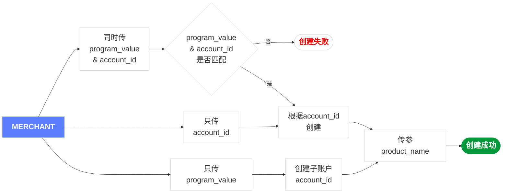

# 

import Tabs from '@theme/Tabs';
import TabItem from '@theme/TabItem';
import Modal from '@site/src/components/Modal';
import CollapsibleTable from '@site/src/components/CollapsibleTable';

## 概述
用于创建卡片并分配至指定账户或卡产品。卡片创建后可用于线上或线下支付，并可通过交易限制规则（如额度、地区、商户类别等）进行使用控制，以保障资金安全与合规性。

## 开始之前
:::info[信息]
创建卡片前，需要先完成必要的参数准备和基础配置，包括请求头设置、持卡人创建、卡产品及账户信息获取，以及卡交易限制规则配置。建议按照流程图的顺序完成相关配置后，再调用创建卡片。
:::

### 流程图




### 设置请求头组
获取已创建的[授权Token](/docs/opcard/auth)。
<Tabs> 
  <TabItem value="Resquest" label="Resquest" default>
```php
cURL -X POST /cards/create
-H 'Content-Type: application/json'
-H 'Authorization: {token}'
```
	</TabItem>  
</Tabs>

### 创建持卡人
- 如果账户已存在默认持卡人，`card_holder_id`为可选参数；
- 如果账户不存在默认持卡人，则需先[创建持卡人](/docs/opcard/manage-card/cardholder/cardholder-create)，获取持卡人 ID `card_holder_id`。
<Tabs> 
  <TabItem value="Response" label="Responses" default>
```json
{
    "data": {
        "card_holder_id": 1955930998425718784
    }
}
```
	</TabItem>  
</Tabs>

### 获取卡产品名称
`product_name`用于标识卡产品名称（Card Product Name），即卡片所属的卡产品、卡段或发卡方案，用于区分不同的卡类型或发卡计划。您可以通过[查询卡产品名称](/docs/opcard/manage-card/product-name)获取`product_name`。
<Tabs> 
  <TabItem value="Response" label="Responses" default>
```json
{
  "data": {
     "program_value": 2,
     "total_count": 1,
     "products": [
        {
            "product_name": "***26452香港Mastercard"
        }
     ]
  }
}
```
	</TabItem>  
</Tabs>

### 获取账户唯一标识
系统生成的账户唯一标识，用于区分不同的商户账户或子账户资金池。创建卡片时可使用[`account_id`](/docs/opcard/manage-card/account)指定卡片归属的主账户或子账户。
<Tabs> 
  <TabItem value="Response" label="Responses" default>
```json
{
  "data": {
     "account_id": "1016X10007530070724",
     "parent_account_id": "1016X10007422220312",
     "creation_time": 1782367203137,
     "modified_time": 1782367203137
  }
}
```
	</TabItem>  
</Tabs>

### 获取账户卡类型
通过[账户卡类型列表](/docs/opcard/create-card/update-card/card-list)获取`program_value`类型：
<Tabs> 
  <TabItem value="Response" label="Responses" default>
```json
{
  "program_value": 2,
  "program_cn_name": "美金单币卡_USD",
  "program_en_name": "Oceanpayment Merchant USD_HOME"
}
```
	</TabItem>  
</Tabs>

### 设置您的卡交易限制
- 设置您的交易限制，其中交易限制的key为`trade_risk_name`，value值为`trade_risk_value`。
- 设置多个限制：当您的卡交易限制有多个规则时，可以通过`risk_list`进行设置。
<Tabs> 
  <TabItem value="Resquest" label="Resquest" default>
```json
{
    "risk_list": [{
         "trade_risk_name": "purchase_count_1d",
         "trade_risk_value": "100"
       },
       {
         "trade_risk_name": "purchase_1d",
         "trade_risk_value": "10"
       },
       {
         "trade_risk_name": "allowed_countries",
         "trade_risk_value": "US,CN"
       }
    ]
}
```
	</TabItem>  
</Tabs>

## 开始创建卡片
<Tabs> 
  <TabItem value="Resquest" label="Resquest" default>
```json
cURL -X POST /card-api/v1/cards/create
-H 'Content-Type: application/json'
-H 'Authorization: {token}'
-d '{
	"card_name": "Personal Card",
	"card_holder_id": "1814356660259814571",
	"card_desc": "Personal spending card",
	"card_validity_time": "203010",
	"product_name": "***26452香港Mastercard",
	"account_id": "1016X10007530070724",
	"program_value": 2,
	"risk_list": [{
			"trade_risk_name": "purchase_count_1d",
			"trade_risk_value": "100"
		},
		{
			"trade_risk_name": "purchase_1d",
			"trade_risk_value": "10"
		},
		{
			"trade_risk_name": "allowed_countries",
			"trade_risk_value": "US,CN"
		}
	]

   }'
```
	</TabItem>  
</Tabs>


<div className="table-container">
<CollapsibleTable
  data={[
  {
    title: "card_name",
    type: "string",
    length: "0-50",
    required: "否",
    desc: "卡片名称",
    example: "Personal Card",
  },
  {
    title: "card_holder_id",
    type: "string",
    length: "0-20",
    required: "有条件",
    desc: "&lt;a href='/docs/opcard/manage-card/cardholder/cardholder-lists'&gt;持卡人ID&lt;/a&gt;",
    example: "1814356660259814571",
  },
  {
    title: "card_desc",
    type: "string",
    length: "0-200",
    required: "否",
    desc: "卡片描述",
    example: "Personal spending card",
  },
  {
    title: "card_validity_time",
    type: "string",
    length: "0-10",
    required: "否",
    desc: "卡有效期<ul><li>格式： yyyyMM</li></ul>",
    example: "203010",
  },
  {
    title: "product_name",
    type: "string",
    length: "1-10",
    required: "是",
    desc: "&lt;a href='/docs/opcard/manage-card/product-name'&gt;卡产品名称&lt;/a&gt;<ul><li>卡产品通过BIN段、发卡国家及卡组织进行区分",
    example: "***26452香港Mastercard",
  },
  {
    title: "account_id",
    type: "string",
    length: "0-20",
    required: "有条件",
    desc: "&lt;a href='/docs/opcard/manage-card/account'&gt;商户账户唯一标识号&lt;/a&gt;<ul><li>与<code>program_value</code>至少传一个，优先级高于<code>program_value</code>",
    example: "1016X10007530070724",
  },
  {
    title: "program_value",
    type: "int",
    length: "0-10",
    required: "有条件",
    desc: "账户卡类型<ul><li>与<code>account_id</code>至少传一个</li><li>通过&lt;a href='/docs/opcard/create-card/add-card/query-card-info#卡片交易限制'&gt;查询卡详细信息&lt;/a&gt;查找已设置的卡片交易限制</li><li>在&lt;a href='/docs/opcard/create-card/update-card/setting-card'&gt;更新卡设置信息&lt;/a&gt;修改您的卡片交易限制</li></ul>",
    example: "2",
  },
  {
    title: "risk_list",
    type: "object",
    length: "-",
    required: "是",
    desc: "交易风险列表",
    example:'{\n  "risk_list": [{\n\u00A0\u00A0\u00A0\u00A0\u00A0"trade_risk_name":"purchase_1d",\n    \u00A0"trade_risk_value":"100"\n  }]\n}',
    children: [
      	  {
	        title: "trade_risk_name",
	        type: "string",
	        length: "1-100",
	        required: "是",
	        desc: "<ul><li>purchase_count_1d: 每日最大交易次数</li><li>purchase_count_7d : 每周最大交易次数</li><li>blocked_countries : 限制交易国家/地区</li><li>allowed_countries : 允许交易国家/地区</li><li>purchase_count_30d : 每月最大交易次数</li><li>purchase_1d : 每日最大交易限额</li><li>purchase_7d : 每周最大交易限额</li><li>purchase_30d : 每月最大交易限额</li><li>purchase_1y : 一年内最大交易金额</li><li>card_debit_lifetime : 卡总限额</li></ul>",
	        example: "purchase_1d"
	      },
	      {
	        title: "trade_risk_value",
	        type: "string",
	        length: "1-100",
	        required: "是",
	        desc: '<ul><li>当<code>trade_risk_name</code>为国家/地区限制时，blocked_countries或 allowed_countries需传入 &lt;a href="/docs/opcard/currency-and-region#支持的国家地区"&gt;ISO 3166-1 Alpha-3&lt;/a&gt;（三位）国家代码。</li><li>其他类型为String，如金额，次数等</li></ul>',
	        example: "100"
	      },
    ]
  },


]}
/>
</div>


## 卡片创建成功
创建卡片成功后，需要使用`card_id`来关联您的卡号信息。
<Tabs> 
  <TabItem value="Response" label="Responses" default>
```json
{
    "code": "200",
    "msg": "操作成功",
    "trace_id": "6b9884b1583847c4a72b2b28525b2535",
    "data": {
        "product_name": "****26452香港Mastercard",
        "card_id": 1954802358738284544,
        "card_number": "527375 **** 4392",
        "card_name": "",
        "card_status": "Activate",
        "create_time": "2025-08-11T15:09:35+08:00",
        "card_remark": null,
        "card_validity_time": "2027-08-01T00:00:00+08:00",
        "card_desc": "",
        "risk_list": [
            {
                "trade_risk_name": "purchase_1d",
                "trade_risk_value": "100"
            },
            {
                "trade_risk_name": "blocked_countries",
                "trade_risk_value": "US"
            }
        ],
        "program_value": 2,
        "program_cn_name": "美金悦享卡_OTA",
        "program_en_name": "USD Multi Card_OTA",
        "card_holder_id": 1950830536975781888,
        "create_status": 1,
        "create_resp_msg": null,
        "account_id": "1016X10034796020144"
    }
}
```
	</TabItem>  
</Tabs>

1. 使用[查询卡号与CVV](/docs/opcard/create-card/add-card/query-card-numbers)获取您的卡号和CVV信息。
2. 接下来使用[查询卡详细信息](/docs/opcard/create-card/add-card/query-card-info)来获取卡片有效期。

## 异步处理说明
创卡完成后，卡片状态可能无法立即同步。建议通过[查询卡片状态](/docs/opcard/create-card/card-status)轮询获取最新状态，并设置合理的重试次数或超时时间，避免无限轮询。