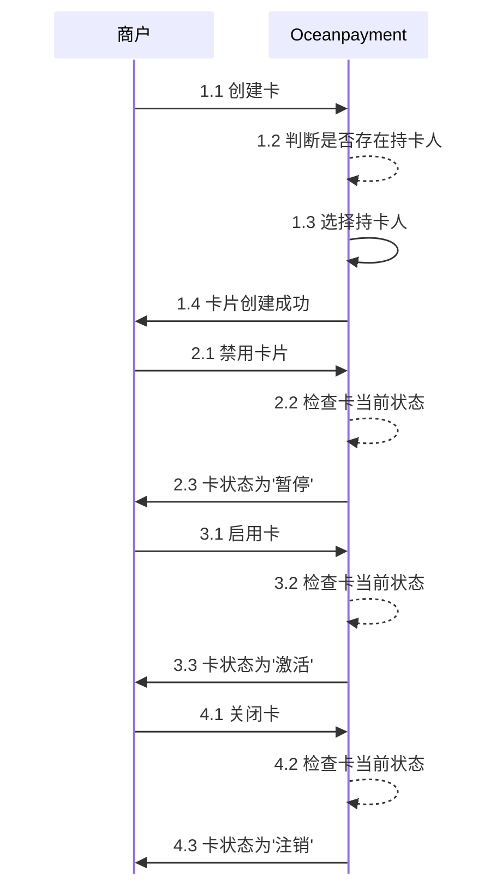

# 
import { FaCode, FaCloudDownloadAlt, FaServer } from 'react-icons/fa';

## 概述
卡片操作流程主要负责**卡片的创建**、**状态管理**和**设置更新**三个核心模块。每个模块都有明确的功能，并通过模块化编码实现高效通信和数据流管理。  

## 卡片操作

  

    
✔️

    

      ### 卡片创建
      - 功能：判断持卡人信息是否存在，创建卡片并设置初始状态。 
      - 流程：验证持卡人信息-> 创建卡片记录，设置初始状态为“暂停” -> 返回创建成功消息。    
      
      [查看文档 →](/docs/opcard/create-card/add-card)
    

  

  
  

    
⚙️

    

      ### 卡片状态管理
      - 功能：管理卡片的状态转换，包括启用、禁用和关闭。
      - 状态：用户禁用卡片，用户启用卡片，卡片永久关闭。  
      
      [查看文档 →](/docs/opcard/create-card/card-status)
    

  

  
  

    
🎯

    

      ### 卡片设置更新
      - 功能: 更新卡片交易限制，检查是否超出最大值。
      - 流程：用户设置新的交易限制 -> 检查是否超出预设最大值 -> 更新设置或提示错误。  
      
      [查看文档 →](/docs/opcard/create-card/update-card/setting-card)
    

  
 
  

## 业务流程

## 开始之前
首先，您需要按照请求[授权令牌](/docs/introduction/generate-key)以与我们的API进行通信。

### 创建持卡人
在创建卡片之前，需要选择持卡人信息，如果您还没有持卡人，需要先[创建持卡人](/docs/opcard/manage-card/cardholder/cardholder-create)。

### 创建卡片
创建您的虚拟卡，并对卡片[设置交易限制](/docs/opcard/create-card/add-card/#设置您的卡交易限制)。

### 启用卡片
创建完卡片后，[启用卡片](/docs/opcard/create-card/card-status)，卡片状态变更为“激活” 。

### 更新卡设置
[更新卡片](/docs/opcard/create-card/update-card/setting-card)的交易限制。

## API参考
👉即刻探索我们的<a href="/docs/opcard-api/virtualcard-creation"><button className="api-button"><FaCode className="w-3 h-3" /> REST API</button></a>。
