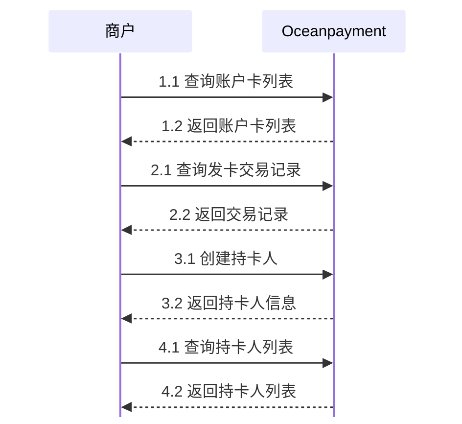

# 
import { FaCode, FaCloudDownloadAlt, FaServer } from 'react-icons/fa';

## 概述
卡片管理主要分为**账户卡管理**、**交易记录管理**和**持卡人管理**三个核心模块。  

## 卡片管理

  

    
⚙️

    

      ### 账户卡管理
      管理当前帐户下所有卡的列表。 
      
      [查看文档 →](/docs/opcard/manage-card/account-card/account-list)
    

  

  
  

    
📚️

    

      ### 交易记录
      查看当前账户的交易记录 
      
      [查看文档 →](/docs/opcard/manage-card/trans-lists)
    

  

  
  

    
🗣️

    

      ### 持卡人
      持卡人信息管理
      
      [查看文档 →](/docs/opcard/manage-card/cardholder/cardholder-create)
    

  
 
  

## 业务流程

## API参考
👉即刻探索我们的<a href="/docs/opcard-api/virtualcard-management"><button className="api-button"><FaCode className="w-3 h-3" /> REST API</button></a>。
