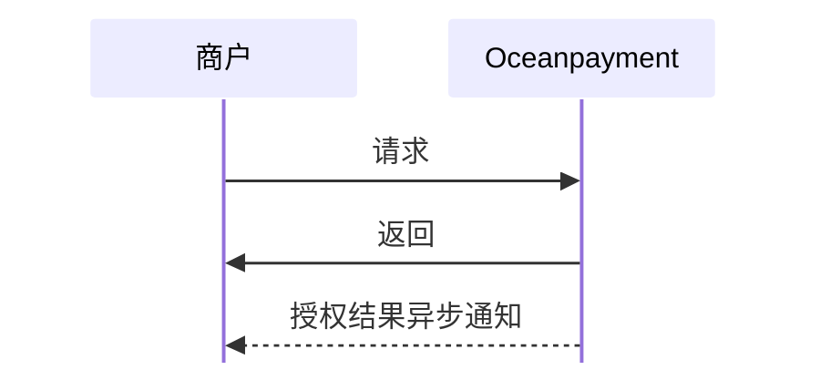

#

import Tabs from '@theme/Tabs';
import TabItem from '@theme/TabItem';

## 概述
安全可靠的预授权支付功能，确保资金安全的同时提供灵活的支付解决方案。支持交易预授权完成和撤销操作。

## 功能描述
- 预授权交易处理
- 授权完成和撤销

## 预授权触发方式
预授权功能支持以下[两种触发方式](/docs/compliance-and-security/preauth)
1. 商户控制预授权：商户在请求参数中明确指定是否使用预授权，由商户自主控制交易类型；
2. Oceanpayment自动控制预授权：由Oceanpayment根据交易场景及风控策略自动判断是否执行预授权，无需商户额外指定参数。

## 授权操作方式
1. API接口操作授权：适用于订单量较大、希望自动化处理的商户，可直接从系统传输数据；
2. [商户后台](https://odpm.oceanpayment.com)手动发起授权操作。

## 流程图



## 授权操作
1. 商户可通过参数 [`payment_authType`](/docs/orders/parameter#预授权管理)实现预授权交易的授权完成（Capture）和授权撤销（Void）操作。
```php
curl -X POST '/gateway/service/auth'
-H 'Content-Type: application/x-www-form-urlencoded'
-d 'account=995149'
-d 'terminal=99514901'
-d 'signValue=6b86b273ff34fce19d6b804eff5a3f5747ada4eaa22f1d49c01e52ddb7875b4b'
-d 'payment_id=180803140041683010528'
-d 'payment_authType=1'
```
<Tabs> 
  <TabItem value="Resquest" label="Resquest" default>
<div className="table-container">
|参数名|类型|长度|是否必填|Description|
| --- | --- | --- | --- | --- |
|`payment_authType`|int|1|是|授权操作<br/>对已预授权交易执行 Capture（完成扣款）或 Void（撤销）操作<ul><li>1: 完成扣款（Capture）</li><li>2: 撤销（Void）</li></ul>|
</div>
	</TabItem>  
</Tabs>

## 响应数据
```xml
<?xml version="1.0" encoding="utf-8"?>
<respon> 
  <account>995149</account>  
  <terminal>99514901</terminal>  
  <signValue>A75EBFFC5CF11EBBF752373115FD1CC1FF4472ACB338EF1E6F303594C656C3D0</signValue>  
  <order_number/>  
  <payment_id>240528151145313026060</payment_id>  
  <payment_status>1</payment_status>  
  <payment_details>Success</payment_details> 
</respon>
```

## 操作结果类型
<div className="table-container">
|返回参数|描述|
| --- | --- |
|`payment_status`|操作结果状态<ul><li>1: 成功</li><li>0: 失败</li></ul>|
|`payment_details`|结果详情<ul><li>格式为：Code:Descrition</li></ul>|

</div>
- 查看完整的预授权操作[返回参数](/docs/orders/parameter#预授权管理)。
- 您也可以通过[异步通知](/docs/webhook/payments/checkout)来接收预授权收操作的结果。