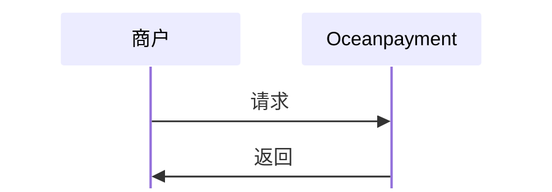

#

## 概述
业务订单详情查询系统提供全面的订单信息查询功能，特别针对风险订单、争议订单和异常订单提供详细的分析和查询能力。系统能够帮助您快速识别和处理问题订单，降低业务风险。

## 功能描述
- 🔍 **全方位订单查询**：支持多种条件组合查询，您也可以通过[异步通知](/docs/webhook/payments/orders)获取业务订单详情
- ⚠️ **风险订单识别**：自动识别高风险订单
- 💸 **退款争议管理**：全面跟踪退款和拒付等处理流程
- 📊 **数据分析报表**：提供多维度的订单汇总
- 🔔 **实时预警通知**：异常订单的实时预警

## 流程图


## 查询业务订单
1. 商户服务器调用业务订单查询功能，提交[必要参数](/docs/orders/parameter#业务订单查询)：
```php
curl -X POST '/service/BusinessOrdersList'
-H 'Content-Type: application/x-www-form-urlencoded'
-d 'account=995149'
-d 'terminal=99514901'
-d 'signValue=6b86b273ff34fce19d6b804eff5a3f5747ada4eaa22f1d49c01e52ddb7875b4b'
-d 'order_beginDate=2025-10-28 15:29:45'
-d 'order_endDate=2025-11-28 15:29:45'
-d 'date_type=0'
```

## 响应数据
```xml
<?xml version="1.0" encoding="utf-8"?>
<response> 
  <account>995149</account>  
  <terminal>99514901</terminal>  
  <signValue>EB7DBDF91F14C9453B73DD69029C830CA99BDAB7AF6447BFFB49837F0024F202</signValue>  
  <results>00</results>  
  <details>Success</details>  
  <count>2</count>  
  <totalpages>1</totalpages>  
  <pages>1</pages>  
  <orderInfo> 
    <account>995149</account>  
    <terminal>99514901</terminal>  
    <type>refund</type>  
    <payment_id>240527141641780010530</payment_id>  
    <order_number>test20240527141619</order_number>  
    <order_currency>HKD</order_currency>  
    <order_amount>0.10</order_amount>  
    <methods>Credit Card</methods>  
    <payment_dateTime>2025-05-27 14:16:41</payment_dateTime>  
    <payment_debitTime>2025-05-27 14:27:25</payment_debitTime>  
    <payment_cpdTime/>  
    <amount>0.10</amount>  
    <status>1</status>  
    <details>test</details> 
  </orderInfo>  
  <orderInfo> 
    <account>995149</account>  
    <terminal>99514901</terminal>  
    <type>chargeback</type>  
    <payment_id>240527091159911010575</payment_id>  
    <order_number>test20240527091152</order_number>  
    <order_currency>HKD</order_currency>  
    <order_amount>0.10</order_amount>  
    <methods>Credit Card</methods>  
    <payment_dateTime>2025-05-27 09:12:00</payment_dateTime>  
    <payment_debitTime>2025-05-27 09:13:41</payment_debitTime>  
    <payment_cpdTime/>  
    <amount>0.10</amount>  
    <status>1</status>  
    <details>test</details> 
  </orderInfo> 
</response>
```

## 业务订单类型
<div className="table-container">
|返回参数|描述|
| --- | --- |
|`results`|业务订单查询结果响应代码|
|`details`|业务订单查询结果详情|
|`orderInfo`|业务订单节点信息<ul><li>出现多个`orderInfo`信息时，即返回的多笔业务订单类型</li></ul>|
|`type`|业务订单类型<ul><li>refund: 全额退款</li><li>partialRefund: 部分金额退款</li><li>chargeback: 拒付</li><li>re-presentment: 申诉</li><li>retrieval: 调单</li><li>reversal-retrieval: 撤销调单</li><li>fraud: 伪冒</li></ul>|
|`status`|业务状态结果<ul><li>0: 未处理</li><li>1: 已处理</li><li>2: 无需处理</li></ul>|
</div>
查看完整的业务订单查询[返回参数](/docs/orders/parameter#业务订单查询)。
