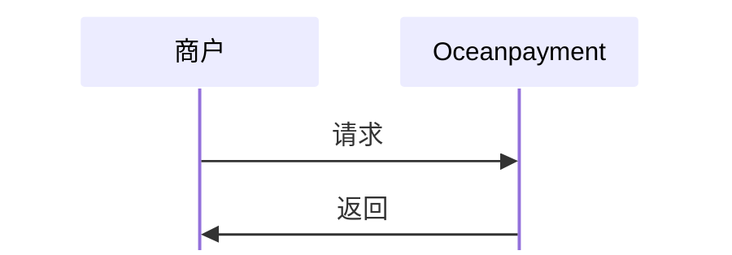

#

## 概述
跨境支付企业向海关上送支付数据，主要是为了配合海关完成跨境电商进口商品的"三单比对"（订单、支付单、物流单）。这是跨境电商零售进口业务通关的核心环节，只有三单信息一致，商品才能顺利清关。支付单是证明交易真实性、完税价格合理性的关键依据。


## 功能描述
- 提供准确的基础信息：确保你的电商平台在海关注册的备案信息准确无误地提供给Oceanpayment，因为这是支付单报文中的重要字段；
- 保持订单信息一致：传给Oceanpayment的订单信息（尤其是订单号、金额）必须与你自有系统以及向海关报送的订单信息保持一致；
- 海关上送只支持上送当前180天内的订单；
- 只有**微信**、**支付宝**和**银联**的交易支持海关上送功能。


## 流程图


## 发起上送
1. 商户服务器调用海关上送功能，将必传参数以及[海关代码`customs`](/docs/orders/parameter#海关上送)传给Oceanpayment；
2. 通过`sub_order_number`子订单号可以进行拆单上送。
```php
curl -X POST '/gateway/service/customsUpload' \
-H 'Content-Type: application/x-www-form-urlencoded'
-d 'account=995149'
-d 'terminal=99514901'
-d 'signValue=6b86b273ff34fce19d6b804eff5a3f5747ada4eaa22f1d49c01e52ddb7875b4b'
-d 'payment_id=180806004457621010532'
-d 'type=1'
-d 'pay_userName=customs'
-d 'price=0.01'
-d 'total_amount=1'
-d 'customs=01'
-d 'customs_number=2012556842365'
-d 'customs_name=company'
-d 'sub_order_number=2012556842365-1'
-d 'shipping_fee=0.99'
```

## 响应数据
```xml
<?xml version="1.0" encoding="utf-8"?>
<response> 
  <account>995149</account>  
  <terminal>99514901</terminal>  
  <signValue>aecc5b6bbdba3e801cb3507dc8278cd9700d79d9bdd10d337691642c8e6e97ee</signValue>  
  <payment_id>240528151145313026060</payment_id>  
  <type>1</type>  
  <status>1</status>  
  <details>Success</details> 
</response>
```

## 上送结果
<div className="table-container">
|返回参数|描述|
| --- | --- |
|`tracking_results`|上传结果代码说明|
</div>
- 查看完整的海关上送[返回参数](/docs/orders/parameter#海关上送)。
- 一旦上送完成，需要通过[异步通知](/docs/webhook/payments/customs-upload)来接收海关上送结果。
- 拆单的每一笔子订单上送结果分别会触发异步通知。