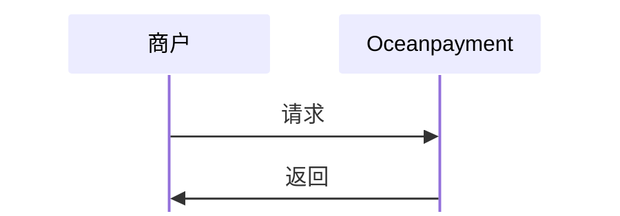

#

## 概述
处理存在争议的订单，提供完整的Klarna争议数据。

## 功能描述
- 按订单号，支付id，日期、争议类型等多条件查询；
- 只能获取`Klarna`支付的争议订单 ；
- 只能查询30天以内的数据；
- 分页参数`pages`默认值为1，每页返回笔数`count`默认值为10。

## 流程图


## 查询争议订单
1. 商户服务器调用Klarna争议订单查询功能，提交[必要参数](/docs/orders/parameter#争议订单查询)：
```php
curl -X POST '/service/DisputeOrderList'
-H 'Content-Type: application/x-www-form-urlencoded'
-d 'account=995149'
-d 'terminal=99514901'
-d 'signValue=6b86b273ff34fce19d6b804eff5a3f5747ada4eaa22f1d49c01e52ddb7875b4b'
-d 'order_beginDate=2025-10-28 15:29:45'
-d 'order_endDate=2025-11-28 15:29:45'
-d 'date_type=dispute'
```

## 响应数据
```xml
<?xml version="1.0" encoding="utf-8"?>
<response> 
  <account>995149</account>  
  <terminal>99514901</terminal>  
  <signValue>afdcfbb0c6b9e78ce87e04124968bb9fed356ea9de330a131c120086e368108f</signValue>  
  <results>00</results>  
  <details>Success</details>  
  <count>1</count>  
  <totalpages/>  
  <pages>1</pages>  
  <orderInfo> 
    <account>995149</account>  
    <terminal>99514901</terminal>  
    <methods>Klarna</methods>  
    <payment_id>230710005935315168469</payment_id>  
    <order_number>1693304542147</order_number>  
    <order_currency>USD</order_currency>  
    <order_amount>10</order_amount>  
    <notice_type>dispute</notice_type>  
    <push_details>return</push_details>  
    <is_refund>2</is_refund>  
    <refund_amount>0</refund_amount>  
    <refund_currency>USD</refund_currency>  
    <is_chargeBack>2</is_chargeBack>  
    <chargeBack_amount>0</chargeBack_amount>  
    <chargeBack_currency>USD</chargeBack_currency>  
    <referrer>https://example.com</referrer>  
    <comment>Please provide return instructions</comment>  
    <abnormal_amount>10</abnormal_amount>  
    <abnormal_currency>USD</abnormal_currency>  
    <disputes_date>2025-08-23 10:27:59.0</disputes_date>  
    <reply_deadline>2025-09-01 23:59:59.0</reply_deadline>  
    <disputes_times>1</disputes_times> 
  </orderInfo> 
</response>
```

## 争议订单处理状态
<div className="table-container">
|返回参数|描述|
| --- | --- |
|`orderInfo`|争议订单节点信息<ul><li>出现多个`orderInfo`信息时，即返回的多笔争议订单</li></ul>|
|`status`|处理状态<ul><li>0: 未处理</li><li>1: 已处理</li><li>2: 无需处理</li></ul>|
|`appeal_status`|是否争议申诉<ul><li>0: 未申诉</li><li>1: 争议申诉中</li></ul>
</div>
查看完整的争议订单查询[返回参数](/docs/orders/parameter#争议订单查询)。
