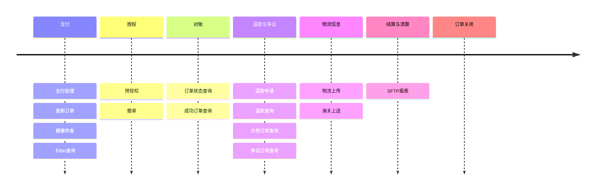

# 
## 概述
Oceanpayment订单管理系统提供了一套完整的工具，帮助您高效管理订单流程，处理各种订单状态，以及退款、预授权、异常订单等相关操作。

<div className="order-tip">
  <div className="orders-title">
    <h1 className="modern-highlight-title">开始使用<br/>订单管理系统</h1>
    <p className="modern-highlight-text">全面掌握订单生命周期，从创建到完成，一站式管理所有订单。</p>
  </div>
  <div className="order-context">
    <h3>快速开始</h3>
    <ul className="order-lists">
      <li>✅ REST接口调用</li>
      <li>✅ 实时查询订单状态</li>
      <li>✅ Webhook通知</li>
    </ul>
    [<span className="modern-highlight-text">开始集成<span className="arrowIcon"> →</span></span>](/docs/orders-api)

  </div>
</div>

## 订单的生命周期
Oceanpayment订单生命周期覆盖从支付发起到订单关闭的完整流程，帮助商户实现安全、高效的跨境支付管理。


## 核心特征
1. 所有的订单管理功能都需要登记您的服务器IP白名单，请联系Oceanpayment技术支持添加；
2. 编码：`UTF-8`；
3. 通用请求头：
```json
Content-Type: application/x-www-form-urlencoded
```
4. 响应格式：
```json
application/xml
```
5. 需要区分[生产和沙盒环境](/docs/introduction/environment#请求地址)。

## 订单
  <div className="opcard-refer">
	  <div className="opcard-plan">
	    <div className="opcard-chunks">🔍</div>
	    <div>
	      ### 订单状态查询
	      <p className="opcard-cons">实时订单状态查询。</p>

	      [查看文档<span className="arrowIcon"> →</span>](/docs/orders/query-orders)
	    </div>
	  </div>
	  
	  <div className="opcard-plan">
	    <div className="opcard-chunks">🔍</div>
	    <div>
	      ### 成功订单查询
	      <p className="opcard-cons">查询成功订单。</p>

	      [查看文档<span className="arrowIcon"> →</span>](/docs/orders/success-orders)
	    </div>
	  </div>
	  	  
	  <div className="opcard-plan">
	    <div className="opcard-chunks">📊</div>
	    <div>
	      ### 业务订单查询
	      <p className="opcard-cons">根据业务类型和分类查询相关订单。</p>

		  [查看文档<span className="arrowIcon"> →</span>](/docs/orders/business-orders)
	    </div>
	  </div>
	  
	  <div className="opcard-plan">
	    <div className="opcard-chunks">⚖️</div>
	    <div>
	      ### 争议订单查询
	      <p className="opcard-cons">处理Klarna异常订单。</p>

	      [查看文档<span className="arrowIcon"> →</span>](/docs/orders/dispute-orders)
	    </div>
	  </div>
	  
	   <div className="opcard-plan">
	    <div className="opcard-chunks">🔐</div>
	    <div>
	      ### 预授权
	      <p className="opcard-cons">支付预授权处理，支持授权和撤销操作。</p>

	      [查看文档<span className="arrowIcon"> →</span>](/docs/orders/auth)
	    </div>
	  </div>
	  
  </div>	  
	  
## 退款	  
<div className="opcard-refer">	  
	  
	  <div className="opcard-plan">
	    <div className="opcard-chunks">↩️</div>
	    <div>
	      ### 退款申请
	      <p className="opcard-cons">支持多种退款场景和支付方式。</p>

	      [查看文档<span className="arrowIcon"> →</span>](/docs/orders/refund)
	    </div>
	  </div>
	  
	  <div className="opcard-plan">
	    <div className="opcard-chunks">🔍</div>
	    <div>
	      ### 退款查询
	      <p className="opcard-cons">查询您的退款结果详情。</p>

	      [查看文档<span className="arrowIcon"> →</span>](/docs/orders/refund#退款查询)
	    </div>
	  </div>  
  </div> 
  

## 物流

 <div className="opcard-refer"> 
  	  <div className="opcard-plan">
	    <div className="opcard-chunks">📦</div>
	    <div>
	      ### 物流单号上传
	      <p className="opcard-cons">物流单号批量上传和管理。</p>

	      [查看文档<span className="arrowIcon"> →</span>](/docs/orders/upload-tracking)
	    </div>
	  </div>
	  
	  <div className="opcard-plan">
	    <div className="opcard-chunks">🛃</div>
	    <div>
	      ### 海关上送
	      <p className="opcard-cons">海关申报数据上报。</p>

	      [查看文档<span className="arrowIcon"> →</span>](/docs/orders/customs-upload)
	    </div>
	  </div>
  </div>
  