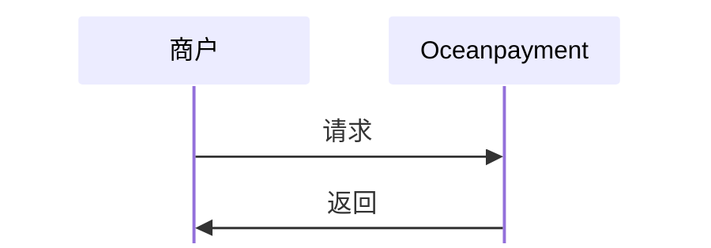

#

## 概述
实时查询订单当前状态，包括成功、失败、待处理等，帮助您及时了解订单进展。

## 功能描述
- 根据订单号条件查询订单状态信息。
- 只能查询当前半年内的订单。

## 流程图


## 查询订单状态
1. 商户服务器调用订单状态查询功能，提交[必要参数](/docs/orders/parameter#订单状态查询)：
```php
curl -X POST '/service/check/normal'
-H 'Content-Type: application/x-www-form-urlencoded'
-d 'account=995149'
-d 'terminal=99514901'
-d 'signValue=6b86b273ff34fce19d6b804eff5a3f5747ada4eaa22f1d49c01e52ddb7875b4b'
-d 'order_number=NO12345678'
```

## 响应数据
```xml
<?xml version="1.0" encoding="UTF-8"?>
<response>
    <paymentInfo>
        <account>995149</account>
        <terminal>99514901</terminal>
        <signValue>C011ED98B1D5181F66C800DB7A3A72EDE59583279D30ED40850C9D3E340B704C</signValue>
        <order_number>NO12345678</order_number>
        <order_currency>USD</order_currency>
        <order_amount>0.01</order_amount>
        <order_sourceUrl>https://example.com</order_sourceUrl>
        <order_notes />
        <methods>Credit Card</methods>
        <payment_id>221111141453082445074</payment_id>
        <payment_results>1</payment_results>
        <payment_details>89999:Contact Customer Service</payment_details>
        <payment_risk>Smart=20.0(R000002=20.0%,)</payment_risk>
        <payment_authCode />
        <payment_eci />
        <payment_dateTime>2022-11-11 14:15:29</payment_dateTime>
        <auth_status>0</auth_status>
        <payment_debitTime>2022-11-11 14:15:29</payment_debitTime>
        <pay_barCode />
        <refund_status>0</refund_status>
        <refundList />
        <chargeBack_status>0</chargeBack_status>
        <chargeBackList />
        <duplicate_status>0</duplicate_status>
        <transactionList />
        <update_status>0</update_status>
        <networkToken>
            <create_status>3</create_status>
            <recurring_type>0</recurring_type>
        </networkToken>
    </paymentInfo>
</response>
```

## 支付状态
<div className="table-container">
|返回参数|描述|
| --- | --- |
|`payment_results`|支付状态<ul><li>-1: 支付待处理（非支付终态），需要等待Oceanpayment的[回调通知](/docs/webhook/payments/checkout)最新支付结果</li><li>1: 支付成功</li><li>0或其他: 支付失败/支付未处理</li></ul>|
|`payment_details`|支付详情<ul><li>格式为：[Code:Descrition](/docs/webhook/payments/checkout)</li></ul>
</div>

查看完整的订单状态查询[返回参数](/docs/orders/parameter#订单状态查询)。
