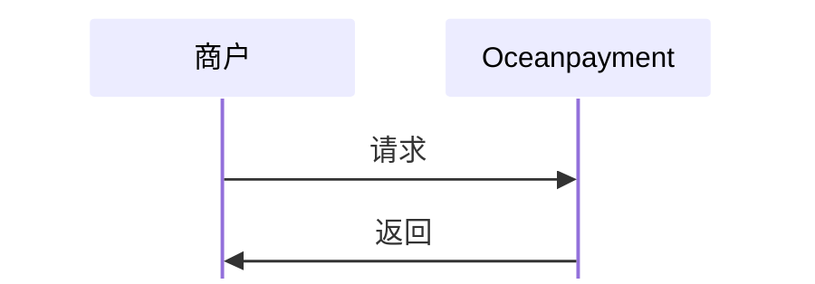
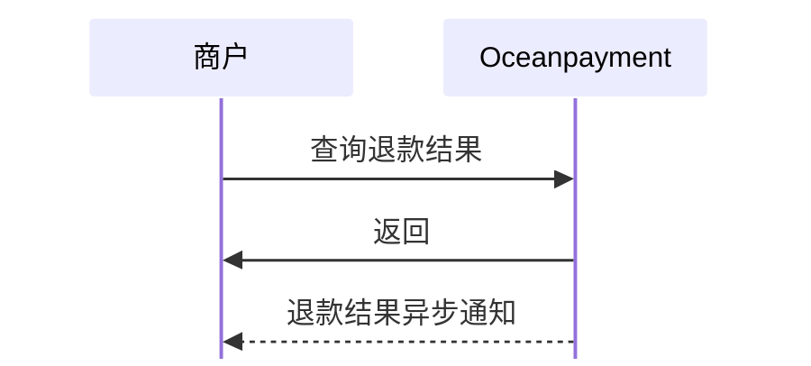

#

## 概述
Oceanpayment退款功能包括退款申请和状态查询。支持全额退款、部分退款等多种退款场景，并提供完善的退款状态跟踪和记录查询功能。

## 功能描述
- 🎯 **灵活退款申请**：支持全额退款、部分退款、多商品退款
- ⚡ **快速审核流程**：自动化审核与人工审核相结合
- 📊 **状态实时跟踪**：完整的退款状态流转和进度查询
- 📝 **详细记录查询**：多维度退款记录查询和统计分析
- 🔔 **消息通知**：实时通知退款状态变化

## 退款类型
退款可分为两种类型：
- 部分退款：退款金额低于实际支付金额。这意味着商家仅退还客户已支付的部分款项，可以发起多次。
- 全额退款：退款金额等于付款金额。这意味着商家将退还客户在交易中支付的全部款项。

## 退款申请

### 退款方式
1. API接口退款：适用于订单量较大、希望自动化处理的商户，可直接从系统传输数据；
2. [商户后台](https://odpm.oceanpayment.com)手动发起退款。


### 流程图


### 发起退款
1. 商户服务器调用退款功能，通过参数[`refund_type`](/docs/orders/parameter#退款申请)发起全额/部分退款：
```php
curl -X POST '/service/applyRefund'
-H 'Content-Type: application/x-www-form-urlencoded'
-d 'account=995149'
-d 'terminal=99514901'
-d 'signValue=6b86b273ff34fce19d6b804eff5a3f5747ada4eaa22f1d49c01e52ddb7875b4b'
-d 'payment_id=180803140041683010528'
-d 'refund_type=1'
-d 'refund_amount=0.01'
-d 'refund_description=refund'
```

### 响应数据
```xml
<?xml version="1.0" encoding="utf-8"?>
<response> 
  <account>995149</account>  
  <terminal>99514901</terminal>  
  <signValue>d40141ae503344826e29256cb3f3992d4566b439042d461f7593dc4f2ddee3cd</signValue>  
  <payment_id>180724171417837026022</payment_id>  
  <order_number/>  
  <refund_number/>  
  <refund_id>0</refund_id>  
  <refund_results>41</refund_results>  
  <refund_description>Refund request has exceeded the acceptable refund period</refund_description>  
  <refund_reference/> 
</response>
```

### 发起退款结果
<div className="table-container">
|返回参数|描述|
| --- | --- |
|`refund_results`|退款发起结果|
|`refund_description`|退款结果原因|
</div>
- 查看完整的退款申请[返回参数](/docs/orders/parameter#退款申请)。

:::warning[注意]
提交了退款申请之后，当账户余额不足会处于待审核状态，之后每天4个时间点（早上8点，中午12点，下午5点，晚上10点）自动查询是否有足够的余额进行退款，如果有就会自动退款，没有就进入等待自动退款的队列中。30天后如果还没有退款成功，系统会停止自动轮询，退款状态变成失败。
- 此时您可以通过[退款查询](/docs/orders/refund#退款查询)功能查询退款的状态；
- 也可以通过[异步通知](/docs/webhook/payments/orders)来接收退款状态。
:::

## 退款使用说明
在调用退款时，建议在请求参数中传入[`refund_number`](/docs/orders/parameter#退款申请)。该参数为商户系统内部生成的唯一退款流水号，用于与原始订单建立关联关系，并会在接口响应中原样返回。

### 退款状态说明
- 当接口返回的`refund_results`值为02时：表示退款请求已受理。 此时无需重复调用退款接口，请等待后续的异步通知获取最终退款结果。 
- 当接口返回的`refund_results`值为25时：表示退款请求失败。针对该`refund_number`，您可以重新发起退款请求。 
:::info[说明]
说明： 针对同一笔退款流水号（refund_number）的退款请求，最终结果以最后一次异步通知为准。
:::

### 退款金额校验
在发起退款请求前，请确保退款金额的合法性，且不得超过订单的剩余可退款金额。  
示例：订单金额：10元，已退款金额：8元 ，剩余可退款金额：2元。若再次发起退款请求，则退款金额不得超过2元。

### 最佳实践
- 为每一笔退款请求生成唯一且可追踪的`refund_number`；
- 在返回 02（已受理）后，避免重复调用退款接口；
- 以异步通知结果作为最终退款状态依据； 
- 在请求前严格校验退款金额，避免超额退款。

## 退款查询

### 流程图



### 查询
1. 商户服务器调用退款查询功能，通过退款申请返回的参数[`refund_id`](/docs/orders/parameter#退款查询)或[`refund_number`](/docs/orders/parameter#退款查询)发起查询：
```php
curl -X POST '/service/queryRefund'
-H 'Content-Type: application/x-www-form-urlencoded'
-d 'account=995149'
-d 'terminal=99514901'
-d 'signValue=6b86b273ff34fce19d6b804eff5a3f5747ada4eaa22f1d49c01e52ddb7875b4b'
-d 'refund_id=180456282544'
-d 'refund_number=180252565585'
```

### 响应数据
```xml
<?xml version="1.0" encoding="utf-8"?>
<response> 
  <account>995149</account>  
  <terminal>99514901</terminal>  
  <signValue>01b3f015ce8b94b824a5fe7b13e5e0527da60d6bfdf511f632ed4aef8a7bedce</signValue>  
  <refund_id>49</refund_id>  
  <refund_number/>  
  <refund_queryNo/>  
  <refund_check>00</refund_check>  
  <refund_description>Refunded</refund_description> 
</response>
```

### 查询结果
<div className="table-container">
|返回参数|描述|
| --- | --- |
|`refund_check`|退款查询结果代码|
|`refund_description`|退款查询原因说明|
</div>