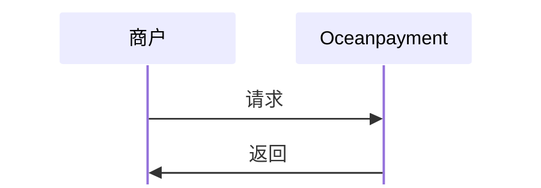

#

## 概述
实时查询成功的订单，帮助您快速统计成功交易数据。

## 功能描述
- 根据时间范围条件查询成功订单信息；
- 只能查询当前半年内的订单；
- 分页参数`pages`默认值为1。

## 流程图


## 查询订单状态
1. 商户服务器调用成功订单查询功能，提交[必要参数](/docs/orders/parameter#成功订单查询)：
```php
curl -X POST '/service/QueryOrdersList'
-H 'Content-Type: application/x-www-form-urlencoded'
-d 'account=995149'
-d 'terminal=99514901'
-d 'signValue=6b86b273ff34fce19d6b804eff5a3f5747ada4eaa22f1d49c01e52ddb7875b4b'
-d 'order_beginDate=2025-10-28 15:29:45'
-d 'order_endDate=2025-11-28 15:29:45'
```

## 响应数据
```xml
<?xml version="1.0" encoding="UTF-8"?>
<response> 
  <account>995149</account>  
  <terminal>99514901</terminal>  
  <signValue>EB7DBDF91F14C9453B73DD69029C830CA99BDAB7AF6447BFFB49837F0024F202</signValue>  
  <results>00</results>  
  <details>Success</details>  
  <count>2</count>  
  <totalpages>1</totalpages>  
  <pages>1</pages>  
  <orderInfo> 
    <account>995149</account>  
    <terminal>99514901</terminal>  
    <payment_id>240527141641780010530</payment_id>  
    <order_number>test20240527141619</order_number>  
    <order_currency>HKD</order_currency>  
    <order_amount>0.10</order_amount>  
    <methods>Credit Card</methods>  
    <payment_dateTime>2024-05-27 14:16:41</payment_dateTime> 
  </orderInfo>  
  <orderInfo> 
    <account>995149</account>  
    <terminal>99514901</terminal>  
    <payment_id>240527091159911010575</payment_id>  
    <order_number>test20240527091152</order_number>  
    <order_currency>HKD</order_currency>  
    <order_amount>0.10</order_amount>  
    <methods>Credit Card</methods>  
    <payment_dateTime>2024-05-27 09:12:00</payment_dateTime> 
  </orderInfo> 
</response>
```

## 统计成功订单
<div className="table-container">
|返回参数|描述|
| --- | --- |
|`orderInfo`|成功订单节点信息<ul><li>出现多个`orderInfo`信息时，即返回的多笔成功订单</li></ul>|
</div>

查看完整的成功订单查询[返回参数](/docs/orders/parameter#成功订单查询)。
