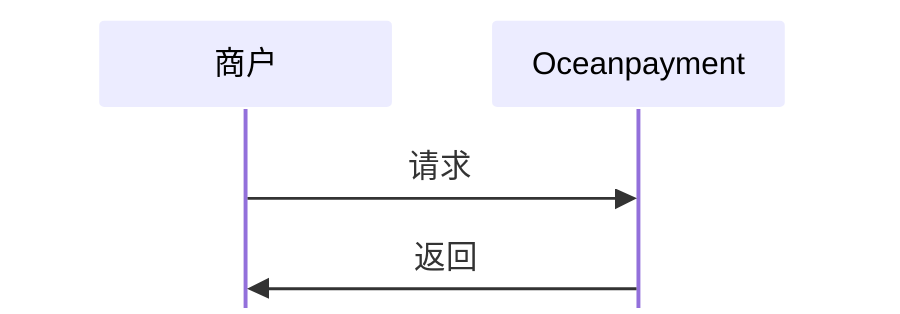

#

## 概述
Oceanpayment的物流单号上传功能，主要是为了帮助使用其支付服务的跨境电商商户，及时将订单的物流追踪信息同步给支付网关。这对满足风控要求、保障资金顺利结算及提升客户体验很重要。

## 上传方式
1. API接口上传：适用于订单量较大、希望自动化处理的商户，可直接从系统传输数据；
2. [商户后台](https://odpm.oceanpayment.com)手动上传：通常提供模板，适合订单量较小或特殊情况。


## 功能描述
- 只能上传当前半年内的物流物流信息；
- 上传或同步物流网址时，填写您发货实际使用的物流公司的网址，注意不要填写：N/A等错误信息、第三方物流平台的网址（例如17Track、Trackdog等），将影响物流信息识别与准确性；
- 物流单号只能填写数字与字母，注意不要使用：空格、“/”等字符，系统将无法识别影响数据判断；
- 如果存在一个订单对应多个物流单号的情况，例如：存在中转单号的情况，则需使用英文的逗号“,”进行分隔。

## 流程图


## 物流上传
1. 商户服务器调用物流上传功能，将物流单号[`tracking_number`](/docs/orders/parameter#物流单号上传)和物流承运商/查询网站[`tracking_site`](/docs/orders/parameter#物流单号上传)传给Oceanpayment：
```php
curl -X POST '/service/uploadTrackingNo'
-H 'Content-Type: application/x-www-form-urlencoded'
-d 'account=995149'
-d 'terminal=99514901'
-d 'signValue=6b86b273ff34fce19d6b804eff5a3f5747ada4eaa22f1d49c01e52ddb7875b4b'
-d 'payment_id=240528151145313026060'
-d 'tracking_number=AB123456789CN'
-d 'tracking_site=https://www.ups.com'
-d 'tracking_number=test'
```

## 响应数据
```xml
<?xml version="1.0" encoding="UTF-8"?>
<response>
  <account>995149</account>
  <terminal>99514901</terminal>
  <signValue>A75EBFFC5CF11EBBF752373115FD1CC1FF4472ACB338EF1E6F303594C656C3D0</signValue>
  <order_number></order_number>
  <payment_id>240528151145313026060</payment_id>
  <tracking_results>01</tracking_results>
</response>
```

## 上传结果
<div className="table-container">
|返回参数|描述|
| --- | --- |
|`tracking_results`|上传结果代码说明|
</div>
- 查看完整的物流单号上传[返回参数](/docs/orders/parameter#物流单号上传)。