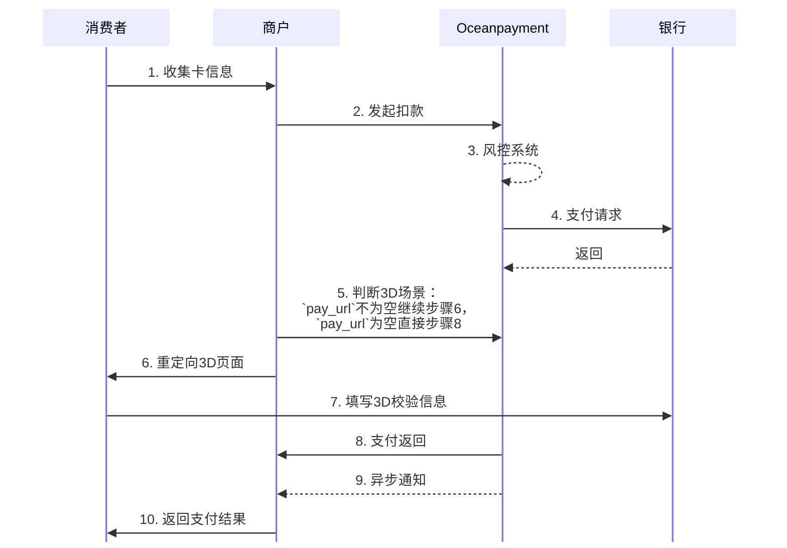

import Tabs from '@theme/Tabs';
import TabItem from '@theme/TabItem';
import CollapsibleTable from '@site/src/components/CollapsibleTable';
import PasswordGate from '@site/src/components/PasswordGate';

<PasswordGate passwordHash="fd270093257f25d8efd50e43488c55386f381ab4e28f31baf82399da6f890093">

# 

## 概述
在服务器对服务器（Server-to-Server，S2S）的集成模式下，商户系统会在其后端服务器中直接收集并处理持卡人的信用卡信息（如卡号、有效期、CVV 等），并通过安全的网络连接将这些数据以明文形式发送至支付服务提供方的接口完成交易请求。
与前端直连或托管支付页面不同，S2S模式下信用卡卡信息不会经过支付平台的前端组件或跳转页面，而是由商户服务器直接发起请求。这种方式通常用于对支付流程、用户体验和交易逻辑有更高定制化需求的场景。
:::warning[开始之前]
开始集成之前，请先阅读Oceanpayment服务器对服务器[信用卡集成合规要求](/docs/payment/server-to-server/integration)。
:::

## 流程图



## 工作原理
1. 商户服务器调用直连模式提交[必要参数](/docs/payment/parameter)，其中持卡人信息可以选择使用明文或加密方式传值：

<Tabs> 
  <TabItem value="信用卡明文" label="信用卡明文" default>
<div className="table-container">
|参数名|类型|长度|是否必填|描述|示例|
| --- | --- | --- | --- | --- | --- |
|`card_number`|string|13-19|是|信用卡卡号<ul><li>持卡人的信用卡卡号，一般为16位，AE为15位</li></ul>|4111111111111111|
|`card_year`|string|1-50|是|信用卡有效期-年<ul><li>格式YYYY</li></ul>|2030|
|`card_month`|string|13-19|是|信用卡有效期-月<ul><li>格式MM</li></ul>|12|
|`card_secureCode`|string|3-4|是|卡背后的安全码<ul><li>一般为3位，AE为4位</li></ul>|123|
|`card_name`|string|0-50|否|持卡人姓名|John Smith|
</div>

2. 签名
<div className="table-container">
|参数名|类型|长度|是否必填|描述|示例|
| --- | --- | --- | --- | --- | --- |
|`signValue`|string|1-64|是|交易安全签名，用于验证交易的安全性。使用SHA256加密，明文加密结构<ul><li>account+terminal+order_number+order_currency+order_amount+card_number<br/>+card_year+card_month+card_secureCode+billing_firstName+billing_lastName<br/>+billing_email+secureCode</li></ul>||
</div>


```php
cURL -X POST 'https://test-secure.oceanpayment.com/gateway/direct/pay'
-H 'Content-Type: application/x-www-form-urlencoded' \
-d 'account=995149' \
-d 'terminal=99514901' \
-d 'signValue=6b86b273ff34fce19d6b804eff5a3f5747ada4eaa22f1d49c01e52ddb7875b4b' \
-d 'backUrl=https://www.abc.com/back.php' \
-d 'noticeUrl=https://www.abc.com/notice.php' \
-d 'order_number=NO12345678' \
-d 'order_currency=USD' \
-d 'order_amount=0.01' \
-d 'methods=Credit Card' \
-d 'card_number=4111111111111111' \
-d 'card_year=2030' \
-d 'card_month=12' \
-d 'card_secureCode=123' \
-d 'order_notes=' \
-d 'billing_firstName=test' \
-d 'billing_lastName=test' \
-d 'billing_email=test@gmail.com' \
-d 'billing_phone=13800138000' \
-d 'billing_country=US' \
-d 'billing_state=AL' \
-d 'billing_city=Washington D.C.' \
-d 'billing_address=705A big Road' \
-d 'billing_zip=529012' \
-d 'billing_ip=127.0.0.1' \
-d 'productNum=1' \
-d 'productName=Red Dress' \
-d 'productSku=#001' \
-d 'productPrice=0.01' \
``` 
 </TabItem>
 
 <TabItem value="信用卡加密" label="信用卡加密" default>
<div className="table-container">
|参数名|类型|长度|是否必填|描述|示例|
| --- | --- | --- | --- | --- | --- |
|`card_data`|string|1-500|是|信用卡卡信息加密串<ul><li>由Oceanpayment提供的加密方式生成</li><li>查看完整的卡信息<a href="/files/op-cse.zip" download>加密示例Demo</a></li></ul>|opcse_0_1_1$ESgIE6St9cSfDbE0+hoh3mz/JNNTS6r2NLNU3d5Pf0SSw2WySdQz|
</div>

2. 签名
<div className="table-container">
|参数名|类型|长度|是否必填|描述|示例|
| --- | --- | --- | --- | --- | --- |
|`signValue`|string|1-64|是|交易安全签名，用于验证交易的安全性。使用SHA256加密，明文加密结构<ul><li>account+terminal+order_number+order_currency+order_amount+billing_firstName<br/>+billing_lastName+billing_email+secureCode</li></ul>||
</div>


```php
cURL -X POST 'https://test-secure.oceanpayment.com/gateway/direct/pay'
-H 'Content-Type: application/x-www-form-urlencoded' \
-d 'account=995149' \
-d 'terminal=99514901' \
-d 'signValue=6b86b273ff34fce19d6b804eff5a3f5747ada4eaa22f1d49c01e52ddb7875b4b' \
-d 'backUrl=https://www.abc.com/back.php' \
-d 'noticeUrl=https://www.abc.com/notice.php' \
-d 'order_number=NO12345678' \
-d 'order_currency=USD' \
-d 'order_amount=0.01' \
-d 'methods=Credit Card' \
-d 'card_data=opcse_0_1_1$ESgIE6St9cSfDbE0+hoh3mz/JNNTS6r2NLNU3d5Pf0SSw2WySdQz' \
-d 'order_notes=' \
-d 'billing_firstName=test' \
-d 'billing_lastName=test' \
-d 'billing_email=test@gmail.com' \
-d 'billing_phone=13800138000' \
-d 'billing_country=US' \
-d 'billing_state=AL' \
-d 'billing_city=Washington D.C.' \
-d 'billing_address=705A big Road' \
-d 'billing_zip=529012' \
-d 'billing_ip=127.0.0.1' \
-d 'productNum=1' \
-d 'productName=Red Dress' \
-d 'productSku=#001' \
-d 'productPrice=0.01' \
``` 
 </TabItem>

</Tabs>


## 处理返回
1. 支付返回获取`pay_url`字段值，判断是否需要3D环节：  
```xml
<?xml version="1.0" encoding="UTF-8"?>
<response>
    <notice_type>transaction</notice_type>
    <push_dateTime>2025-12-19 09:52:47</push_dateTime>
    <account>995149</account>
    <terminal>99514901</terminal>
    <signValue>D6315600AE0002C1468DC9B943E17E90B314E73581393ABC332B92985E41B100</signValue>
    <methods>GooglePay</methods>
    <order_number>NO12345678</order_number>
    <card_country>PL</card_country>
    <order_currency>USD</order_currency>
    <order_amount>0.01</order_amount>
    <order_notes></order_notes>
    <card_number>411111***1111</card_number>
    <card_type>Visa</card_type>
    <payment_country></payment_country>
    <payment_id>231219095247018026021</payment_id>
    <payment_authType>3</payment_authType>
    <payment_status>-1</payment_status>
    <payment_details>80093:3D Authorized Service not completed</payment_details>
    <payment_solutions></payment_solutions>
    <payment_risk></payment_risk>
    <payment_amount></payment_amount>
    <payment_exchangeRate></payment_exchangeRate>
    <auth_reason></auth_reason>
    <auth_code></auth_code>
    <pay_userId></pay_userId>
    <pay_url>https://test-secure.oceanpayment.com:443/gateway/direct/redirect?pay_id=2dfb964bb67134ba6ed72183a4eecfc5f35f4364745f75e12f50f33b6ac74ef8</pay_url>
</response>
```
- 如果xml->pay_url字段为空，无3D验证环节，则xml就是返回的支付结果。此时会触发noticeUrl异步通知。   
- 如果xml->pay_url字段不为空，有3D验证环节，需要重定向打开pay_url完成3D校验，此时支付返回结果会再次发送至backUrl，默认用$_POST接收返回。此时也会触发noticeUrl异步通知。  
  - 商户将用户重定向到`pay_url` ：
```php
HTTP/1.2 301 Moved Permanently
Location: {pay_url}
``` 
2. 查看[付款状态说明](/docs/payment/status)，您也需要通过`noticeUrl`获取交易的[异步通知](/docs/webhook/payments/checkout)。


## 签名
支付返回签名SHA256校验格式：
```PHP
account+terminal+order_number+order_currency+order_amount+order_notes+card_number+payment_id+payment_authType+payment_status+payment_details+payment_risk+secureCode
```

</PasswordGate>
