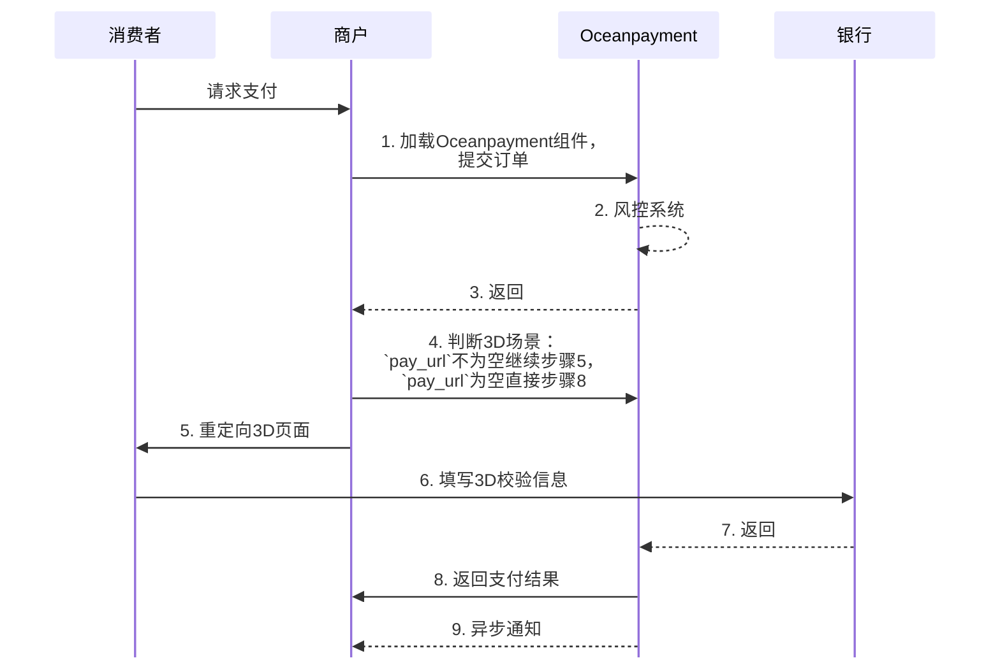

# 
import { FaCode, FaCloudDownloadAlt, FaServer } from 'react-icons/fa';
import Tabs from '@theme/Tabs';
import TabItem from '@theme/TabItem';


## 概述
通过通过Oceanpayment JS SDK将支付表单直接嵌入到您的checkout页面中。用户无需跳转即可完成支付，完美保持品牌一致性。
<div className="hero-embedded-ux">
  <div className="hero-embedded-ux-content">
    <div className="hero-embedded-ux-text">
      <h2 className="hero-embedded-ux-title">嵌入式(Embedded)</h2>
      <div className="hero-embedded-ux-subtitle">
        嵌入式支付让客户在您的网站内完成付款，无需跳转到第三方页面。减少支付过程中的流失，显著提高转化率。
      </div>
      
      <div className="hero-embedded-ux-benefits">
        <div className="hero-embedded-ux-benefit hero-embedded-ux-benefit-1">
          <div className="hero-embedded-ux-benefit-icon">📈</div>
          <div className="hero-embedded-ux-benefit-content">
            <div className="hero-embedded-ux-benefit-title">提高转化率</div>
            <div className="hero-embedded-ux-benefit-desc">减少页面跳转带来的用户流失，支付成功率提升高达30%</div>
          </div>
        </div>
        
        <div className="hero-embedded-ux-benefit hero-embedded-ux-benefit-2">
          <div className="hero-embedded-ux-benefit-icon">🎨</div>
          <div className="hero-embedded-ux-benefit-content">
            <div className="hero-embedded-ux-benefit-title">品牌一致性</div>
            <div className="hero-embedded-ux-benefit-desc">完全自定义支付表单样式，与您的网站设计完美融合</div>
          </div>
        </div>
        
        <div className="hero-embedded-ux-benefit hero-embedded-ux-benefit-3">
          <div className="hero-embedded-ux-benefit-icon">🚀</div>
          <div className="hero-embedded-ux-benefit-content">
            <div className="hero-embedded-ux-benefit-title">流畅体验</div>
            <div className="hero-embedded-ux-benefit-desc">无中断的支付流程，提供类似原生应用的流畅体验</div>
          </div>
        </div>
      </div>
      <div className="hero-modern-buttons">
      	[<span className="button click-buttons">开始集成</span>](/docs/payment-api/embedded)
      </div>	
    </div>
    
    <div className="hero-embedded-ux-visual">
      <div className="hero-embedded-ux-device">
        <div className="hero-embedded-ux-device-frame">
          <div className="hero-embedded-ux-device-header">
            <div className="hero-embedded-ux-device-logo">OP</div>
            <div className="hero-embedded-ux-device-title">最受欢迎的支付解决方案</div>
          </div>
          
          <div className="hero-embedded-ux-device-form">
            
          </div>
        </div>
      </div>
    </div>
  </div>
</div>


## 开始之前
:::warning[注意]
嵌入式集成方案只支持**信用卡**，**Google Pay**，**Apple Pay**支付方式。
:::

## 流程图




## 工作原理
<Tabs> 
  <TabItem value="Credit Card" label="Credit Card" default>
1. 在页面中引入Oceanpayment的JS SDK：
```javascript
//加载Oceanpayment Js文件
<script src="https://secure.oceanpayment.com/pages/js/oceanpayment.js"></script>
//加载Jquery
<script src="https://secure.oceanpayment.com/pub/js/jquery/jq.js"></script>
```

2. 在页面上创建一个`<div>`容器：
```javascript
//加载Oceanpayment支付页面
<div id="oceanpayment-element"></div>
```

3. 使用初始化并渲染支付UI组件到容器中，初始化`init();`
- 传值`true`提交沙盒环境；
- 传空提交生产环境。
```javascript
<script>
  $(function() {
    //传true提交沙盒环境，传空提交生产环境
    Oceanpayment.init(true,'','');
  });
</script>
```

4. 提交支付
- 调用支付方法，支付时需要做防重复提交处理；
- 使用方法`transformToJson(formData){}`将提交的必填参数转为`Json`格式；
- 再调用`checkout()`[提交必要参数](/docs/payment/parameter)给Oceanpayment支付网关。
```javascript
//提交参数
<script>
  //支付方法
  function pay() {
    //获取form表单元素
    var register = $("#payForm");
    //Jquery的serialize()方法
    var formData = register.serializeArray();
    //提交参数信息给Oceanpayment支付网关
    Oceanpayment.checkout(transformToJson(formData));
  }
  
  //输出Json数据
  function transformToJson(formData){
    var obj={}
    for (var i in formData) {
      obj[formData[i].name]=formData[i]['value'];
    }
    return obj;
  }
</script>
```

 </TabItem>
 <TabItem value="Google Pay" label="Google Pay">
1. 在页面中引入Oceanpayment的JS SDK：
```javascript
//加载Oceanpayment Js文件
<script src="https://secure.oceanpayment.com/pages/js/oceanpayment-googlepay.js"></script>
//加载Jquery
<script src="https://secure.oceanpayment.com/pub/js/jquery/jq.js"></script>
```

2. 在页面上创建一个`<div>`容器：
```javascript
//加载Google Pay支付按钮
<div id="oceanpayment-googlepayelement"></div>
```

3. 使用初始化并渲染支付UI组件到容器中，初始化`init();`
- 传值`true`提交沙盒环境；
- 传空提交生产环境。
```javascript
//初始化Oceanpayment
<script>
   $(function() {
        //传true提交沙盒环境，传空提交生产环境。
        onePageGooglePay.init(true, {
            cssUrl: '',/*传入线上css样式文件地址，可以控制按钮大小*/
            transactionInfo: {
                //*传入订单实际的金额，币种，国家
                orderCurrency:ORDER_CURRENCY,/*交易币种*/
                orderAmount:ORDER_AMOUNT,/*交易金额*/
                billCountry:BILLING_COUNTRY,/*账单国家*/
            },
            buttonStyle: {
                buttonColor:'',/*按钮颜色*/
                buttonType:'',/*按钮类型*/
                buttonRadius:'',/*圆角*/
                buttonSizeMode:'',/*尺寸样式*/
                buttonLocale:''/*按钮语言*/
            }
        });
  });
</script>
```

4. 提交支付
- 调用支付方法，支付时需要做防重复提交处理；
- 使用方法`transformToJson(formData){}`将提交的必填参数转为`Json`格式；
- 再调用`checkout()`[提交必要参数](/docs/payment/parameter)给Oceanpayment支付网关。
```javascript
//提交参数
<script>
//Oceanpayment支付方法
  function opGooglepay() {
    //获取form 表单元素
    var register = $("#payForm");
    //Jquery的serialize()方法
    var formData = register.serializeArray();
    //提交参数信息给Oceanpayment支付网关
    onePageGooglePay.checkout(transformToJson(formData));
  }
  //输出Json数据
  function transformToJson(formData){
    var obj={}
    for (var i in formData) {
      obj[formData[i].name]=formData[i]['value'];
    }
    return obj;
  }
</script>
```
 </TabItem>
 
  <TabItem value="Apple Pay" label="Apple Pay">
:::warning[开始之前]
Apple Pay使用嵌入式集成时，商户必须先为其注册的每个域名[添加Oceanpayment托管域名验证文件](/docs/payment/methods/applepay#嵌入式)。
:::
1. 在页面中引入Oceanpayment的JS SDK：
```javascript
//加载Oceanpayment Js文件
<script src="https://secure.oceanpayment.com/pages/js/oceanpayment-applepay.js"></script>
//加载Jquery
<script src="https://secure.oceanpayment.com/pub/js/jquery/jq.js"></script>
```

2. 在页面上创建一个`<div>`容器：
```javascript
//加载Apple Pay支付按钮
<div id="oceanpayment-applepayelement"></div>
```
3. 使用初始化并渲染支付UI组件到容器中，初始化`init();`
- 传值`true`提交沙盒环境；
- 传空提交生产环境。
```javascript
//初始化Oceanpayment
<script>
   $(function() {
        //传true提交沙盒环境，传空提交生产环境。
        onePageApplePay.init(true, {
            terminal: '', /*Oceanpayment终端号*/
            cssUrl: '',/*传入线上css样式文件地址，可以控制按钮大小*/
            transactionInfo: {
                //*传入订单实际的金额，币种，国家
                orderCurrency:ORDER_CURRENCY,/*交易币种*/
                orderAmount:ORDER_AMOUNT,/*交易金额*/
                billCountry:BILLING_COUNTRY,/*账单国家*/
                orderNumber:ORDER_NUMBER,/*订单号*/
                billAddress:BILLING_ADDRESS /*账单地址*/
            },
            buttonStyle: {
                buttonstyle:'', /*按钮颜色*/
                type:'' /*按钮类型*/
            }
        });
  });
</script>
```
4. 提交支付
- 调用支付方法，支付时需要做防重复提交处理；
- 使用方法`transformToJson(formData){}`将提交的必填参数转为`Json`格式；
- 再调用`checkout()`[提交必要参数](/docs/payment/parameter)给Oceanpayment支付网关。
```javascript
//提交参数
<script>
//Oceanpayment支付方法
  function opApplepay() {
    //获取form 表单元素
    var register = $("#payForm");
    //Jquery的serialize()方法
    var formData = register.serializeArray();
    //提交参数信息给Oceanpayment支付网关
    onePageApplePay.checkout(transformToJson(formData));
  }
  //输出Json数据
  function transformToJson(formData){
    var obj={}
    for (var i in formData) {
      obj[formData[i].name]=formData[i]['value'];
    }
    return obj;
  }
</script>
```
 </TabItem>
</Tabs>


## 处理返回
1. 前端监听支付结果事件，后端通过[异步通知](/docs/webhook/payments/checkout)确认最终结果。
:::warning[注意]
Oceanpayment将支付返回结果发送至`backUrl`页面，backUrl传值一定要和当前页面的**地址和完整路径完全一致**，才能调用`CallBack()`方法接收支付返回信息。
:::

<Tabs> 
  <TabItem value="Credit Card" label="Credit Card" default>
```javascript
var oceanpaymentCallBack = function(data){}
```
2. 当卡信息校验失败时，`data.msg`会返回报错信息，例如：
```json
//卡号输入错误
{"code":-1, "msg":"Your credit card number is incorrect."}
```
3. 当`data.msg`返回为空时，表示卡信息校验通过。在`else`中接收支付返回，判断以下两个场景：
- 如果xml->`pay_url`字段为空，无3D验证环节，则xml就是返回的支付结果。此时也会触发`noticeUrl`异步通知。
- 如果xml->`pay_url`字段不为空，有3D验证环节，需要重定向打开pay_url完成3D校验，此时支付返回结果会再次发送至`backUrl`，默认用$_POST接收返回。此时也会触发noticeUrl异步通知。
```javascript
var oceanpaymentCallBack = function(data){	
    if(data.msg){
       //处理卡信息错误
       console.log(data.msg);
    }else{
       //处理下单返回
       //没有报错时，接收backUrl返回，解析返回xml
       console.log(data);
    }	
}
```

 </TabItem>
 
 <TabItem value="Google Pay" label="Google Pay">
```javascript
var oceanpaymentGooglePayCallBack = function(data){}
```
2. 当`data.code` == 2，表示Google Pay按钮加载成功。在`else`中接收支付返回，判断以下两个场景：
- 如果xml->`pay_url`字段为空，则xml就是返回的支付结果。此时也会触发`noticeUrl`异步通知。
- 如果xml->`pay_url`字段不为空，则需要重定向打开pay_url完成3D校验，此时支付返回结果会再次发送至`backUrl`，默认用$_POST接收返回。此时也会触发noticeUrl异步通知。
```javascript
var oceanpaymentGooglePayCallBack = function(data){	
   if (data.code == 2) {
      //唤起按钮，调用支付
      opGooglepay();
   }else{
      /*处理下单返回*/
      //console.log(data);
   }
}
```
3. 当`data.code` == 3，表示用户关闭了Google Pay支付弹窗，数据返回格式：
```json
{"code":3,"msg":"","method":"GooglePay"}
```
 </TabItem>
 
  <TabItem value="Apple Pay" label="Apple Pay">
```javascript
var oceanpaymentApplePayCallBack = function(data){}
```
2. 当`data.code` == 2，表示Apple Pay按钮加载成功。在`else`中接收支付返回，判断以下两个场景：
- 如果xml->`pay_url`字段为空，则xml就是返回的支付结果。此时也会触发`noticeUrl`异步通知。
- 如果xml->`pay_url`字段不为空，则需要重定向打开pay_url完成3D校验，此时支付返回结果会再次发送至`backUrl`，默认用$_POST接收返回。此时也会触发noticeUrl异步通知。
```javascript
var oceanpaymentApplePayCallBack = function(data){	
   if (data.code == 2) {
      //唤起按钮，调用支付
      opApplepay();
   }else{
      /*处理下单返回*/
      //console.log(data);
   }
}
```
3. 当`data.code` == 3，表示用户关闭了Apple Pay支付弹窗，数据返回格式：
```json
{"code":3,"msg":"","method":"GooglePay"}
```
 </TabItem>
</Tabs>

4. 返回示例：
<Tabs> 
  <TabItem value="3D场景" label="3D场景" default>
```xml
<?xml version="1.0" encoding="UTF-8"?>
<response>
    <notice_type>transaction</notice_type>
    <push_dateTime>2025-09-03 10:21:14</push_dateTime>
    <account>995149</account>
    <terminal>99514901</terminal>
    <signValue>924347D8E9C9BAC2EC91449C70540FF49E0DD5711F03E8A871DCA34CED023AB6</signValue>
    <methods>Credit Card</methods>
    <order_number>JSCSE-3128790866</order_number>
    <card_country>PL</card_country>
    <order_currency>USD</order_currency>
    <order_amount>0.01</order_amount>
    <order_notes></order_notes>
    <card_number>411111***1111</card_number>
    <card_type>Visa</card_type>
    <payment_country></payment_country>
    <payment_id>250902111334242179639</payment_id>
    <payment_authType>2</payment_authType>
    <payment_status>-1</payment_status>
    <payment_details>80093:3D Authorized Service not completed</payment_details>
    <payment_solutions></payment_solutions>
    <payment_risk></payment_risk>
    <payment_amount></payment_amount>
    <payment_exchangeRate></payment_exchangeRate>
    <auth_reason></auth_reason>
    <auth_code></auth_code>
    <pay_userId></pay_userId>
    <pay_url>https://secure.oceanpayment.com:443/gateway/direct/redirect?pay_id=af5e28ee57061f4fd1dd307a7bc56c7289d9041d0b5494195d91b7c5166b6e30</pay_url>
</response>
```
- 商户将用户重定向到`pay_url` ：
```php
HTTP/1.2 301 Moved Permanently
Location: {pay_url}
``` 
  </TabItem>
  <TabItem value="非3D场景" label="非3D场景">
```xml
<?xml version="1.0" encoding="UTF-8"?>
<response>
    <notice_type>transaction</notice_type>
    <push_dateTime>2025-09-03 10:21:14</push_dateTime>
    <account>995149</account>
    <terminal>99514901</terminal>
    <signValue>6E48108837603DF6758BD6CE81C9F8AEE6FDC40D14D056C41EBCC1B28B1F2A0D</signValue>
    <methods>Credit Card</methods>
    <order_number>JSCSE-3128790866</order_number>
    <card_country>PL</card_country>
    <order_currency>USD</order_currency>
    <order_amount>0.01</order_amount>
    <order_notes></order_notes>
    <card_number>411111***1111</card_number>
    <card_type>Visa</card_type>
    <payment_country>-</payment_country>
    <payment_id>250903102114589130422</payment_id>
    <payment_authType>0</payment_authType>
    <payment_status>1</payment_status>
    <payment_details>80000:Transaction Approved</payment_details>
    <payment_solutions>None required.</payment_solutions>
    <payment_risk></payment_risk>
    <payment_amount></payment_amount>
    <payment_exchangeRate></payment_exchangeRate>
    <auth_code></auth_code>
    <pay_userId></pay_userId>
</response>
```
  </TabItem>
</Tabs>
5. 查看[付款状态说明](/docs/payment/status)，您也需要通过`noticeUrl`获取交易的[异步通知](/docs/webhook/payments/checkout)。

## 签名
查看详细的[签名和验签](/docs/compliance-and-security/sign/payment)功能。

## API参考
👉即刻探索我们的<a href="/docs/payment-api/embedded"><button className="api-button"><FaCode className="w-3 h-3" /> REST API</button></a>。
