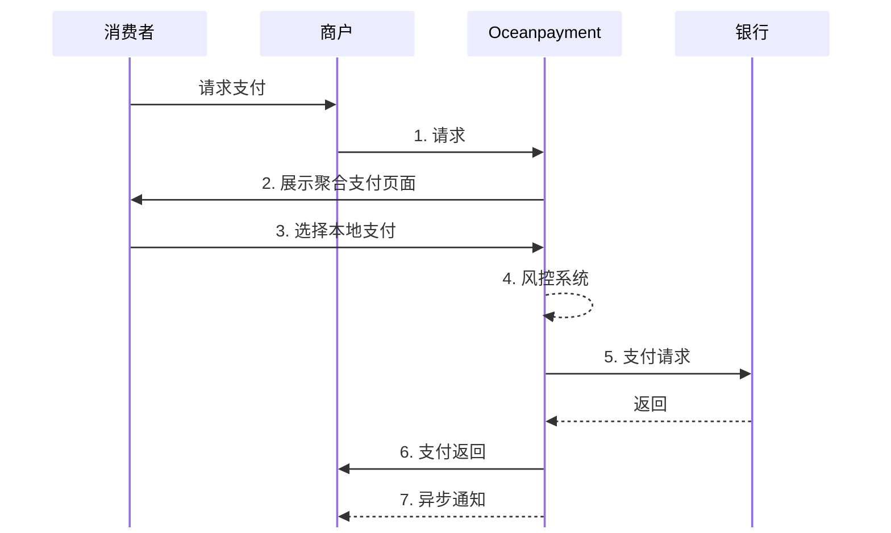

#

## 概述
Oceanpayment的支付聚合页面（Hosted Payment Page, HPP） 是一种标准化的支付解决方案，该页面由Oceanpayment托管，符合国际支付合规与安全标准。为全球商户提供一站式支付接入能力，支持多币种、多支付方式、多终端的收款需求。

## 流程图

## 集成方式
1. 和[托管结账](/docs/payment/host-page/integration)请求方式一致，商户在集成时，只需将用户重定向至Oceanpayment提供的安全支付页面，即可支持多种支付方式，而无需自行开发复杂的支付UI或处理敏感信息。
2. 一旦决定使用聚合支付页面时，此时请求字段[`methods`](/docs/payment/parameter#通用参数所有接口必传)不需要传值。

## 支持的支付方式
Oceanpayment支付聚合页面支持[500+支付方式](/docs/payment/methods/list)，一次集成即可覆盖全球本地支付。
:::warning[注意]
信用卡和Klarna支付方式有单独的支付页面处理，不建议通过支付聚合方式来集成。  
:::

## 功能模块
- 托管在Oceanpayment平台，保证安全与合规；
- 自适应布局，支持 PC、H5、移动端展示；
- 动态显示支持的支付方式（根据用户账单或IP国家地区智能匹配）。

## 支付聚合效果图

