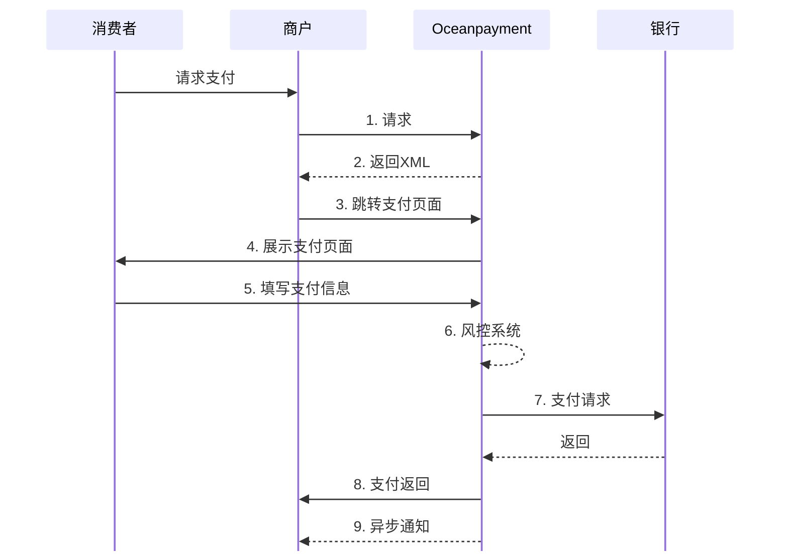
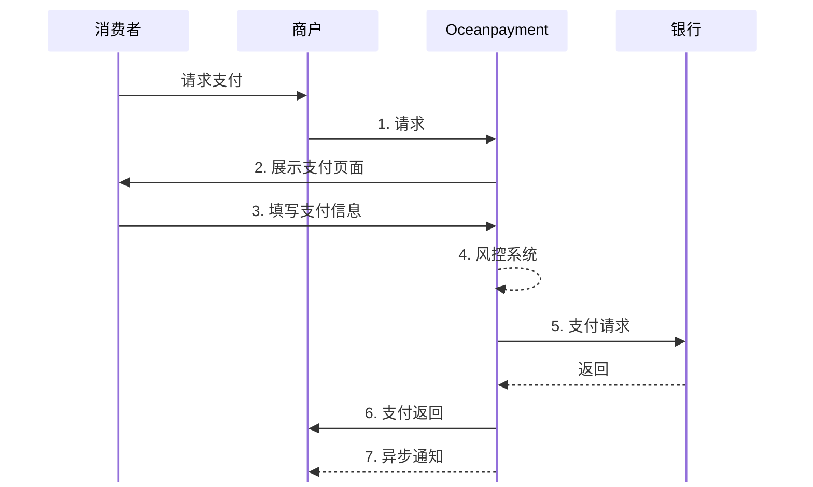

import { FaCode, FaCloudDownloadAlt, FaServer } from 'react-icons/fa';
import Tabs from '@theme/Tabs';
import TabItem from '@theme/TabItem';

# 

## 概述
托管结账 (Hosted Checkout)：用户会重定向到Oceanpayment安全、托管的支付页面完成交易。这是最快速、简单的集成方式。
<div className="hero-modern">
  <div className="hero-modern-content">
    <div className="hero-modern-text">
      <h2 className="hero-modern-title">托管结账<span className="no-break">(Hosted Checkout)</span></h2>
      <div className="hero-modern-subtitle">
        Oceanpayment托管结账解决方案让您无需处理复杂的支付集成和安全合规问题
      </div>
      
      <div className="hero-modern-highlights">
        <div className="hero-modern-highlight">
          <span className="hero-modern-highlight-icon">✓</span>
          <span>无需PCI DSS合规认证，降低技术门槛</span>
        </div>
        <div className="hero-modern-highlight">
          <span className="hero-modern-highlight-icon">✓</span>
          <span>无缝支付快速集成，支持全球250+支付方式</span>
        </div>

        <div className="hero-modern-highlight">
          <span className="hero-modern-highlight-icon">✓</span>
          <span>专业支付页面，信用卡支持24+支付语言</span>
        </div>
      </div>
      
      <div className="hero-modern-buttons">
		[<span className="button click-buttons">开始集成</span>](/docs/payment-api/host-page-controlled)
      </div>
    </div>
    
    <div className="hero-modern-visual">
      
      
    </div>
  </div>
</div>

## 集成方式
在托管结账（Hosted Checkout） 模式下，Oceanpayment提供两种不同的重定向处理方式，以满足商户在支付流程控制、用户体验和系统架构上的不同需求。两种方式仅在 支付完成后的跳转逻辑上存在差异，支付能力与安全机制保持一致。
- [商户控制重定向](/docs/payment/host-page/integration#工作原理)
- [Oceanpayment自动重定向](/docs/payment/host-page/integration#工作原理)  

## 工作原理

<Tabs> 
  <TabItem value="商户控制重定向" label="商户控制重定向" default>
**流程图** 


 1. 商户服务器调用Hosted Checkout[提交必要参数](/docs/payment/parameter)创建交易：
```php
cURL -X POST 'https://test-secure.oceanpayment.com/gateway/service/sendTrade' \
-H 'Content-Type: application/x-www-form-urlencoded' \
-d 'account=995149' \
-d 'terminal=99514901' \
-d 'signValue=6b86b273ff34fce19d6b804eff5a3f5747ada4eaa22f1d49c01e52ddb7875b4b' \
-d 'backUrl=https://www.abc.com/back.php' \
-d 'noticeUrl=https://www.abc.com/notice.php' \
-d 'order_number=NO12345678' \
-d 'order_currency=USD' \
-d 'order_amount=0.01' \
-d 'methods={{methods}}' \
-d 'order_notes=' \
-d 'billing_firstName=test' \
-d 'billing_lastName=test' \
-d 'billing_email=test@gmail.com' \
-d 'billing_phone=13800138000' \
-d 'billing_country=US' \
-d 'billing_state=AL' \
-d 'billing_city=Washington D.C.' \
-d 'billing_address=705A big Road' \
-d 'billing_zip=529012' \
-d 'billing_ip=127.0.0.1' \
-d 'productNum=1' \
-d 'productName=Red Dress' \
-d 'productSku=#001' \
-d 'productPrice=0.01' \
``` 
2. 获取`pay_url` ：
```xml
<?xml version="1.0" encoding="UTF-8"?>
<respon>
    <account>995149</account>
    <terminal>99514901</terminal>
    <signValue>20303645096FC2AEB64AE39B72A846F4B83BBC90B123C3FB27567F46CDD676E8</signValue>
    <order_number>20230322B2COW03431</order_number>
    <order_currency>HKD</order_currency>
    <order_amount>0.1</order_amount>
    <order_notes></order_notes>
    <payment_id>231205114442682010542</payment_id>
    <pay_url>https://test-secure.oceanpayment.com:443/gateway/service/redirect?pay_id=b6e6cf9d407ce1801f62c9d204c53e512c060ffdcbc56</pay_url>
    <pay_results>1</pay_results>
    <pay_details>0000:Success</pay_details>
</respon>
``` 

3. 商户将用户重定向到该URL：
```php
HTTP/1.2 301 Moved Permanently
Location: {pay_url}
``` 
4. 用户在Oceanpayment页面上选择支付方式并付款；
5. 支付完成后，用户被重定向回商户网站[`backUrl`](/docs/payment/parameter#请求参数)页面。

  </TabItem>

  
  <TabItem value="Oceanpayment自动重定向" label="Oceanpayment自动重定向">
  
**流程图** 

  
  1. 商户前端Form表单调用Hosted Checkout[提交必要参数](/docs/payment/parameter)：

```html
<form action="https://test-secure.oceanpayment.com/gateway/service/pay" method="post">
  <input type="hidden" name="account" value="995149" />
  <input type="hidden" name="terminal" value="99514901" />
  <input type="hidden" name="order_number" value="NO12345678" />
  <input type="hidden" name="order_currency" value="USD" />
  <input type="hidden" name="order_amount" value="0.01" /> 
  <input type="hidden" name="signValue" value="egh4fjs2f3h4mc5g3j7676vzva53gfd33dfga1458fe2f12343y" />
  <input type="hidden" name="backUrl" value="http://www.abc.com/result.php" />
  <input type="hidden" name="noticeUrl" value="http://www.abc.com/notice.php" />
  <input type="hidden" name="methods" value="Credit Card" />
  <input type="hidden" name="billing_firstName" value="test" />
  <input type="hidden" name="billing_lastName" value="test" />
  <input type="hidden" name="billing_email" value="test@test.com" />
  <input type="hidden" name="billing_phone" value="0755-123456789" />
  <input type="hidden" name="billing_country" value="US" />
  <input type="hidden" name="billing_city" value="Washington D.C." />
  <input type="hidden" name="billing_address" value="705A big Road" />
  <input type="hidden" name="billing_zip" value="529012" />
  <input type="hidden" name="productSku" value="#001" />
  <input type="hidden" name="productName" value="dress" />
  <input type="hidden" name="productNum" value="1" />
  <input type="submit" value="Submit" />
</form>
```
  2. 用户在Oceanpayment页面上选择支付方式并付款；
  3. 支付完成后，用户被重定向回商户网站。
  </TabItem>
</Tabs>

## 处理返回
在支付结果处理中，
- 同步返回结果依赖于`backUrl`：
<Tabs> 
  <TabItem value="Response" label="Response" default>
```json
//表单POST返回：
Array
(
    [response_type] => 0
    [account] => 995149
    [terminal] => 99514901
    [signValue] => F03C3D5154FC2672C5EC05BAD3DDDF0892617CC1517517DCD37E6499AA896D73
    [methods] => Credit Card
    [order_number] => NO12345678
    [order_currency] => USD
    [order_amount] => 0.01
    [order_notes] => 
    [card_number] => 
    [card_type] => null
    [payment_country] => US
    [payment_id] => 221214134817000529042
    [payment_Method] => Credit Card
    [payment_authType] => 2
    [payment_status] => 1
    [payment_details] => 80000:Transaction Approved
    [payment_solutions] => None required.
    [payment_risk] => 
    [payment_amount] => null
    [payment_exchangeRate] => null
    [pay_userId] => null
    [pay_barCode] => 
    [payment_bankInfo] => 
)
```  
  </TabItem>
</Tabs>
- 您也需要通过`noticeUrl`获取交易的[异步通知](/docs/webhook/payments/checkout)。
- 查看[付款状态说明](/docs/payment/status)。

## 签名
在托管结账中，以上两种集成方式`SignValue`的签名格式是不相同的，查看详细的[签名和验签](/docs/compliance-and-security/sign/payment)功能。

## API参考
👉即刻探索我们的<a href="/docs/payment-api/host-page-controlled"><button className="api-button"><FaCode className="w-3 h-3" /> REST API</button></a>。
