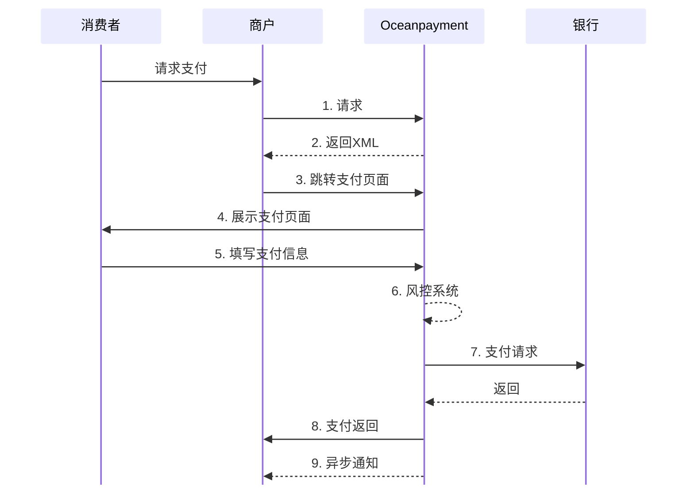

import { FaCode, FaCloudDownloadAlt, FaServer } from 'react-icons/fa';

# 

<div className="plug-box">
  <div className="plug-line">
    <h1 className="plug-title">
      <span className="plug-span"/>
      	Oceanpayment支付链接<br/>
      	快速提升销量
    </h1>
    <div className="plug-content">
              无需编程或技术开发，秒级创建专属品牌支付链接
    </div>
    <ul className="plug-list">
      {[
        '✅ 随时随地接受付款，无需搭建独立电商网站',
        '✅ 提供顺畅支付体验，覆盖更多客户，助力快速转化下单，提升营收',
        '✅ 令牌化处理和3D Secure（3DS）身份验证，保障交易安全'
      ].map(item => (
        <li key={item} className="plug-li">
          {item}
        </li>
      ))}
    </ul>
    [开始集成<span className="arrowIcon"> →</span>](/docs/payment-api/link)
  </div>
  <div className="plug-img">
     
  </div>
 
</div>

## 工作原理
1. 在Oceanpayment账户后台或者API集成方式设置商品、金额、订单号；
2. 生成一个支付链接或二维码；
3. 通过邮件、短信、社交媒体等任何方式发送给客户；
4. 客户点击链接，在OceanPayment页面完成支付。


## 集成方式
针对付款链接的场景，我们有三种方式：
<div className="table-container">
|对接方案|方案说明|支持的支付方式|订单有效期|
| --- | --- | --- | --- |
|[创建Payment Link](/docs/payment/link/integration#创建订单)|无操作界面，通过API集成|目前仅支持信用卡|默认48小时，可配置|
|Moto|通过[账户后台](https://odpm.oceanpayment.com)-【Moto订单】|目前仅支持信用卡|默认48小时，可配置|
|Link|通过账户后台-【Link管理】|目前仅支持信用卡，微信，支付宝，银联|默认48小时，可配置|
</div>

## 流程图


## 创建订单
商户服务器调用付款链接Payment Link，提交[必要参数](/docs/payment/parameter)创建订单：
```php
cURL -X POST 'https://test-secure.oceanpayment.com/gateway/service/moto' \
-H 'Content-Type: application/x-www-form-urlencoded' \
-d 'account=995149' \
-d 'terminal=99514901' \
-d 'signValue=6b86b273ff34fce19d6b804eff5a3f5747ada4eaa22f1d49c01e52ddb7875b4b' \
-d 'backUrl=https://www.abc.com/back.php' \
-d 'noticeUrl=https://www.abc.com/notice.php' \
-d 'order_number=NO12345678' \
-d 'order_currency= USD' \
-d 'order_amount= 0.01' \
-d 'methods=Credit Card' \
-d 'order_notes=' \
-d 'productNum=1' \
-d 'productName=Red Dress' \
-d 'productSku=#001' \
-d 'productPrice=0.01' \
```
2. 获取`MOTO_url` 支付链接：
```xml
<?xml version="1.0" encoding="UTF-8"?>
<respon>
  <account>995149</account>
  <terminal>99514901</terminal>
  <signValue>82ae484ccbc2e6f28dd4dd2a759046459a16ee34b8a8cb5acd522c1890602eb6</signValue>
  <order_number>NO12345678</order_number>
  <order_currency>USD</order_currency>
  <order_amount>1.99</order_amount>
  <order_notes></order_notes>
  <payment_id>180808092746539010540</payment_id>
  <MOTO_url>https://test-secure.oceanpayment.com/gateway/service/moto?moto_id=684</MOTO_url>
  <MOTO_results>1</MOTO_results>
  <MOTO_details>Success</MOTO_details>
</respon>
``` 
3. 商户将用户重定向到该URL：
```php
HTTP/1.2 301 Moved Permanently
Location: {MOTO_url}
``` 
4. 用户在Oceanpayment页面上选择支付方式并付款；
5. 支付完成后，用户被重定向回商户backUrl页面。

## 处理返回
在支付结果处理中，
- 同步返回结果依赖于[`backUrl`](/docs/payment/parameter)地址接收；
- 您也需要通过`noticeUrl`获取交易的[异步通知](/docs/webhook/payments/checkout)；
- 查看[付款状态说明](/docs/payment/status)。

## 签名
查看详细的[签名和验签](/docs/compliance-and-security/sign/payment)功能。

## API参考
👉即刻探索我们的<a href="/docs/payment-api/link"><button className="api-button"><FaCode className="w-3 h-3" /> REST API</button></a>。
