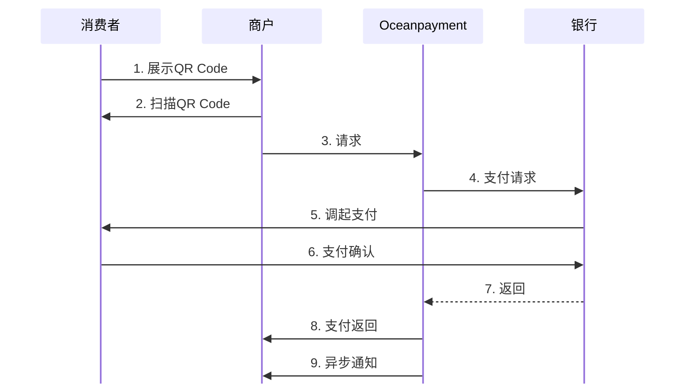
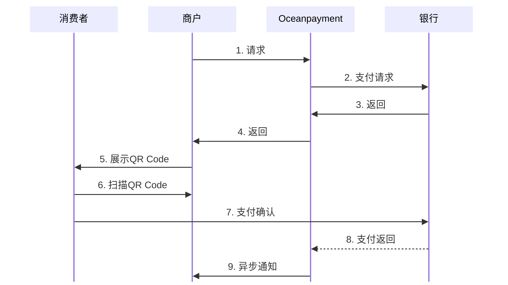

# 

import { FaCode, FaCloudDownloadAlt, FaServer } from 'react-icons/fa';
import Tabs from '@theme/Tabs';
import TabItem from '@theme/TabItem';

<div className="plug-box">
<div className="plug-img">
     
  </div>
  <div className="plug-line">
    <h1 className="plug-title">面对面付款</h1>
    <div className="plug-content">
             专为线下实体场景设计，通过智能POS终端、扫码设备或移动App完成收款。
    </div>
    <ul className="plug-list">
      {[
        '✔️ 专为线下场景设计的支付解决方案',
        '✨️ 让线下收款变得简单高效',
        '🔎 支持主扫、被扫等多种支付方式'
      ].map(item => (
        <li key={item} className="plug-li">
          {item}
        </li>
      ))}
    </ul>
    [开始集成<span className="arrowIcon"> →</span>](/docs/payment-api/pos)
  </div>
</div>


## 开始之前
:::warning[注意]
面对面付款方案只支持**微信**、**支付宝**线下场景支付方式。
:::

## 集成方式
我们有两种面对面付款方式，选择您合适的方式进行集成：
- [商户扫码消费者](/docs/payment/pos/integration#工作原理)
- [消费者扫码商户](/docs/payment/pos/integration#工作原理)


## 工作原理
1. 集成Oceanpayment的线下支付到您的POS系统或收银App中；

<Tabs> 
  <TabItem value="商户扫码消费者" label="商户扫码消费者" default>
  
**流程图**

  
2. 通过调用扫描客户的付款码（主扫），将支付授权码[`pay_accountNumber`](/docs/payment/parameter#附加参数本地支付)传给Oceanpayment
```php
cURL -X POST 'https://test-secure.oceanpayment.com/gateway/directservice/pay' \
-H 'Content-Type: application/x-www-form-urlencoded' \
-d 'account=995149' \
-d 'terminal=99514901' \
-d 'signValue=6b86b273ff34fce19d6b804eff5a3f5747ada4eaa22f1d49c01e52ddb7875b4b' \
-d 'noticeUrl=https://www.abc.com/notice.php' \
-d 'order_number=NO12345678' \
-d 'order_currency=USD' \
-d 'order_amount=0.01' \
-d 'methods=' \
-d 'order_notes=' \
-d 'billing_firstName=test' \
-d 'billing_lastName=test' \
-d 'pay_accountNumber=123456789' \
-d 'billing_email=test@gmail.com' \
-d 'billing_phone=13800138000' \
-d 'billing_country=US' \
-d 'billing_state=AL' \
-d 'billing_city=Washington D.C.' \
-d 'billing_address=705A big Road' \
-d 'billing_zip=529012' \
-d 'billing_ip=127.0.0.1' \
-d 'productNum=1' \
-d 'productName=Red Dress' \
-d 'productSku=#001' \
-d 'productPrice=0.01' \
``` 
  3. Oceanpayment处理支付请求并返回支付结果。
  </TabItem>

  <TabItem value="消费者扫码商户" label="消费者扫码商户">
**流程图**


  
  2. 通过请求Oceanpayment支付返回收款码QR Code链接，

```php
curl -X POST 'https://secure.oceanpayment.com/gateway/directservice/pay' \
-H 'Content-Type: application/x-www-form-urlencoded' \
-d 'account=995149' \
-d 'terminal=99514901' \
-d 'signValue=6b86b273ff34fce19d6b804eff5a3f5747ada4eaa22f1d49c01e52ddb7875b4b' \
-d 'noticeUrl=http://www.abc.com/notice.php' \
-d 'order_number=NO12345678' \
-d 'order_currency=USD' \
-d 'order_amount=0.01' \
-d 'methods=WeChatPay_Offline' \
-d 'order_notes=' \
-d 'billing_firstName=Vergil' \
-d 'billing_lastName=Pan' \
-d 'billing_email=test@gmail.com' \
-d 'billing_phone=13800138000' \
-d 'billing_country=US' \
-d 'billing_state=AL' \
-d 'billing_city=Washington D.C.' \
-d 'billing_address=705A big Road' \
-d 'billing_zip=529012' \
-d 'billing_ip=127.0.0.1' \
-d 'ship_firstName=Vergil' \
-d 'ship_lastName=Pan' \
-d 'ship_email=test@gmail.com' \
-d 'ship_phone=13800138000' \
-d 'ship_country=US' \
-d 'ship_state=AL' \
-d 'ship_city=Washington D.C.' \
-d 'ship_addr=705A big Road' \
-d 'ship_zip=529012' \
-d 'productNum=1' \
-d 'productName=Red Dress' \
-d 'productSku=#001' \
-d 'productPrice=0.01' \
```
3. 将返回的收款码参数`pay_barCode`转换为QR Code二维码，被客户扫描（被扫）：
```xml
<?xml version="1.0" encoding="UTF-8"?>
<response>
    <notice_type>transaction</notice_type>
    <push_dateTime>2024-05-06 10:15:51</push_dateTime>
    <account>995149</account>
    <terminal>99514901</terminal>
    <signValue>5CF2E48721069E4E8C77A063FE8B348319C14A5EBA6956444902AE6BDB97F2D1</signValue>
    <methods>WeChatPay_Offline</methods>
    <order_number>NO12345678</order_number>
    <card_country></card_country>
    <order_currency>USD</order_currency>
    <order_amount>0.01</order_amount>
    <order_notes></order_notes>
    <card_number></card_number>
    <card_type></card_type>
    <payment_country></payment_country>
    <payment_id>240506101548268260914</payment_id>
    <payment_authType>0</payment_authType>
    <payment_status>-1</payment_status>
    <payment_details></payment_details>
    <payment_solutions></payment_solutions>
    <payment_risk></payment_risk>
    <payment_amount></payment_amount>
    <payment_exchangeRate></payment_exchangeRate>
    <customer_id></customer_id>
    <subscribe></subscribe>
    <pay_bankCode></pay_bankCode>
    <pay_barCode>2024050622001432901441897816</pay_barCode>
    <pay_userId>137****8623</pay_userId>
</response>
```
  4. Oceanpayment处理支付请求并返回支付结果。
  </TabItem>
</Tabs>

## 处理返回
```xml
<?xml version="1.0" encoding="UTF-8"?>
<response>
    <notice_type>transaction</notice_type>
    <push_dateTime>2024-05-06 10:15:51</push_dateTime>
    <account>995149</account>
    <terminal>99514901</terminal>
    <signValue>5CF2E48721069E4E8C77A063FE8B348319C14A5EBA6956444902AE6BDB97F2D1</signValue>
    <methods>WeChatPay_Offline</methods>
    <order_number>NO12345678</order_number>
    <card_country></card_country>
    <order_currency>USD</order_currency>
    <order_amount>0.01</order_amount>
    <order_notes></order_notes>
    <card_number></card_number>
    <card_type></card_type>
    <payment_country></payment_country>
    <payment_id>240506101548268260914</payment_id>
    <payment_authType>0</payment_authType>
    <payment_status>1</payment_status>
    <payment_details>80000:Transaction Approved</payment_details>
    <payment_solutions></payment_solutions>
    <payment_risk></payment_risk>
    <payment_amount></payment_amount>
    <payment_exchangeRate></payment_exchangeRate>
    <customer_id></customer_id>
    <subscribe></subscribe>
    <pay_bankCode></pay_bankCode>
    <pay_barCode>2024050622001432901441897816</pay_barCode>
    <pay_userId>137****8623</pay_userId>
</response>
```

- 您也需要通过`noticeUrl`获取交易的[异步通知](/docs/webhook/payments/checkout)。
- 查看[付款状态说明](/docs/payment/status)。

## 签名
查看详细的[签名和验签](/docs/compliance-and-security/sign/payment)功能。

## API参考
👉即刻探索我们的<a href="/docs/payment-api/pos"><button className="api-button"><FaCode className="w-3 h-3" /> REST API</button></a>。
