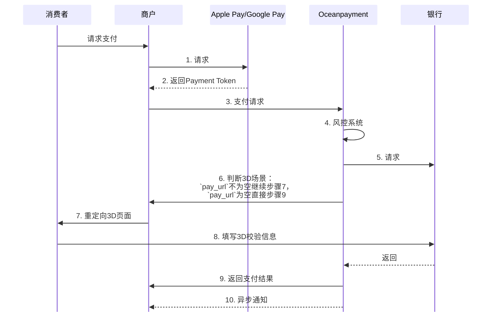
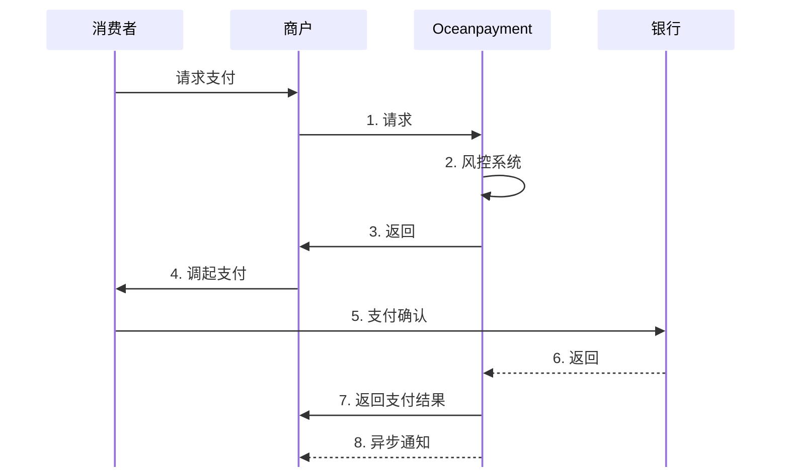

import Modal from '@site/src/components/Modal';
import Tabs from '@theme/Tabs';
import TabItem from '@theme/TabItem';

# 

## 概述
<section className="hero-split">
  <div className="hero-split-content">
    <h1 className="hero-split-title">服务器对服务器</h1>
    <p className="hero-split-subtitle">也称为“直连API”。由您的服务器直接与Oceanpayment的API通信。最适合需要完全自定义支付流程的场景。</p>
    - 🔒️ PCI DSS合规保障
    - ⚡ 无缝支付快速集成
    - 🎉 全设备响应式设计
  </div>
  
  <div className="hero-split-graphic">
    <div className="webhook-visual">
      <div className="webhook-node"> </div>
      <div className="webhook-node"> </div>
      <div className="webhook-node"> </div>
      <div className="webhook-connection"></div>
      <div className="webhook-connection"></div>
    </div>
  </div>
</section>


## 信用卡集成
在此对接模式下，由于商户的服务器环境会直接接触、处理或传输持卡人数据 (Cardholder Data, CHD)，因此商户的系统被纳入[PCI DSS](/docs/compliance-and-security/pci-dss)的合规范围。
1. **商户服务器负责**：从终端客户（前端）收集支付信息（如卡号、有效期、CVV等），并将其通过加密方式传递给 Oceanpayment；
2. **Oceanpayment负责**：接收支付信息、处理交易、返回支付结果、并与银行/卡组织进行结算。


### 核心合规要求
选择此集成模式，意味着商户同意并承诺履行相关的 PCI DSS合规义务。Oceanpayment作为支付网关，已通过[PCI DSS LEVEL 1](https://www.oceanpayment.com/cn/about-us/%e8%8d%a3%e8%aa%89%e8%b5%84%e8%b4%a8)认证，但这并不能免除商户自身的合规责任。
<div className="table-container">
|责任方|责任范围|
| --- | --- |
|Oceanpayment|负责自身平台和基础设施的安全，确保支付网关接口符合 PCI DSS要求|
|商户|负责自身系统、网络、应用程序以及处理、存储或传输持卡人数据方式的安全，确保符合 PCI DSS要求|
</div>

### 强制性对接要求
为确保支付环境的安全性和合规性，采用 S2S模式的商户必须满足以下要求：
1. **严禁永久存储敏感认证数据**
- 严格禁止在任何地方（数据库、日志文件、监控系统等）存储完整的磁条数据、卡验证码 (CAV2/CVC2/CVV2/CID)或 PIN块。  
2. **强制使用加密传输**
- 商户服务器与 Oceanpayment API 端点之间的所有通信必须使用强加密协议；
- 最低要求：TLS1.2 或更高版本。禁用 SSL和早期版本的TLS；
- 必须配置安全的加密套件，禁用不安全的算法和协议。
3. **提供[PCI DSS LEVEL 1证书](https://www.pcisecuritystandards.org/assessors_and_solutions/approved_scanning_vendors)**
- 商户需要每年完成一次PCI证书更新，以及AOC文件。
4. **季度性[ASV安全扫描报告](https://www.pcisecuritystandards.org/assessors_and_solutions/approved_scanning_vendors)**
- 商户必须每季度至少一次对其所有面向系统（如 Web服务器、API端点、防火墙等）进行外部漏洞扫描；
- 扫描频率：每季度一次（例如：Q1, Q2, Q3, Q4）。在首次上线前，也必须提交一份合格的报告。

### 合规流程指南
1. **预审阶段**：在启动技术对接前，商户应阅读本文件并自我评估能否满足要求。
2. **技术对接**：商户开发团队根据 Oceanpayment的 API文档进行开发集成，必须遵循本文档中的安全要求。
3. **提交与审核**：将“合格”的ASV报告和签署的PCI DSS LEVEL 1证书通过邮件发送 Oceanpayment团队进行审核备案。

### 重要声明
- 如果商户未能按时提交合格的ASV扫描报告和PCI证书或无法证明其合规性，Oceanpayment有权暂停支付服务或要求切换[其他技术对接方案](/docs/payment/introduction)，以确保整体支付环境的安全；
- 本文件是对PCI DSS要求的概要性解读，最终解释权以[PCI安全标准委员](https://www.pcisecuritystandards.org)会发布的官方文档为准。

### 下一步行动
如果您确认接受以上要求并计划继续集成，请邮件联系我们。我们的技术客户经理将为您提供完整的API文档和测试凭证。  
如有任何关于技术对接合规流程的疑问，请随时联系我们的技术支持团队：techservice@oceanpayment.com.cn


## 本地支付集成
### 工作原理

:::info[信息]
除信用卡外，本地支付场景没有卡信息收集，不涉及PCI DSS合规要求，支持Apple Pay，Google Pay，微信，支付宝，FPS等直连对接。
:::
<Tabs> 
  <TabItem value="Apple Pay&Google Pay" label="Apple Pay&Google Pay" default>
:::warning[开始之前]
使用服务器对服务器集成时，商户需要分别注册[Apple Pay](/docs/payment/methods/applepay#服务器对服务器)和[Google Pay](/docs/payment/methods/googlepay#服务器对服务器)官方开发者账号，调用Payment Token流程获取卡信息Token，将卡信息Token参数一并传给Oceanpayment。
:::

**流程图**


 1. 商户服务器调用直连模式[提交必要参数](/docs/payment/parameter)， 其中[`pay_accountNumber`](/docs/payment/parameter#附加参数本地支付)参数是商户请求Apple Pay和Google Pay返回的卡信息token值。  
- `methods`枚举：ApplePay，GooglePay；
- `card_type`为必传，查看[传值规则](/docs/payment/parameter#附加参数本地支付)。
```php
cURL -X POST 'https://test-secure.oceanpayment.com/gateway/direct/pay'
-H 'Content-Type: application/x-www-form-urlencoded' \
-d 'account=995149' \
-d 'terminal=99514901' \
-d 'signValue=6b86b273ff34fce19d6b804eff5a3f5747ada4eaa22f1d49c01e52ddb7875b4b' \
-d 'backUrl=https://www.abc.com/back.php' \
-d 'noticeUrl=https://www.abc.com/notice.php' \
-d 'order_number=NO12345678' \
-d 'order_currency=USD' \
-d 'order_amount=0.01' \
-d 'methods={{methods}}' \
-d 'order_notes=' \
-d 'pay_accountNumber={"data":"ned7UHi3Uti0VPrayQVZ7lIEBBeahdv02bFf65k4xVNzoMCm1ansTK+dbeoCb5doLRIm7FWYjJOmUE2/HMARrDShl0fNWn5V+2sX6WhhY7RwV13XD5BFJ3bqb8LvuzeWhX2ILKfQ9n3KqGXrTQC8M+YrbHS0eQZXBFBSlNeebn+izrbSzk+xmxBXGrK1R8/ov7q+i5/1q64+a0Eh1QGscBbweOuvBOsJl1CSSYvoRXF3GTHO1c80fGE1GWtHBPjDmhtjl7Al57lZPBenfnA/PXCx1NeUQPJcfNIXY/Ax9q2GjVk2nfXyGepvB8cXpdYZ7gqCo6V13B28D7qX3/AJo1CWEeH8ulVNbRu2sJKoE5/vIOmXXmUJY/2gwCQOnebXxtLjGlOJO8DiOAFDEdQx6pGpi9Ckzi8S7IU294s=","signature":"MIAGCSqGSIb3DQEHAqCAMIACAQExDTALBglghkgBZQMEAgEwgAYJKoZIhvcNAQcBAACggDCCA+MwggOIoAMCAQICCBZjTIsOMFcXMAoGCCqGSM49BAMCMHoxLjAsBgNVBAMMJUFwcGxlIEFwcGxpY2F0aW9uIEludGVncmF0aW9uIENBIC0gRzMxJjAkBgNVBAsMHUFwcGxlIENlcnRpZmljYXRpb24gQXV0aG9yaXR5MRMwEQYDVQQKDApBcHBsZSBJbmMuMQswCQYDVQQGEwJVUzAeFw0yNDA0MjkxNzQ3MjdaFw0yOTA0MjgxNzQ3MjZaMF8xJTAjBgNVBAMMHGVjYy1zbXAtYnJva2VyLXNpZ25fVUM0LVBST0QxFDASBgNVBAsMC2lPUyBTeXN0ZW1zMRMwEQYDVQQKDApBcHBsZSBJbmMuMQswCQYDVQQGEwJVUzBZMBMGByqGSM49AgEGCCqGSM49AwEHA0IABMIVd+3r1seyIY9o3XCQoSGNx7C9bywoPYRgldlK9KVBG4NCDtgR80B+gzMfHFTD9+syINa61dTv9JKJiT58DxOjggIRMIICDTAMBgNVHRMBAf8EAjAAMB8GA1UdIwQYMBaAFCPyScRPk+TvJ+bE9ihsP6K7/S5LMEUGCCsGAQUFBwEBBDkwNzA1BggrBgEFBQcwAYYpaHR0cDovL29jc3AuYXBwbGUuY29tL29jc3AwNC1hcHBsZWFpY2EzMDIwggEdBgNVHSAEggEUMIIBEDCCAQwGCSqGSIb3Y2QFATCB/jCBwwYIKwYBBQUHAgIwgbYMgbNSZWxpYW5jZSBvbiB0aGlzIGNlcnRpZmljYXRlIGJ5IGFueSBwYXJ0eSBhc3N1bWVzIGFjY2VwdGFuY2Ugb2YgdGhlIHRoZW4gYXBwbGljYWJsZSBzdGFuZGFyZCB0ZXJtcyBhbmQgY29uZGl0aW9ucyBvZiB1c2UsIGNlcnRpZmljYXRlIHBvbGljeSBhbmQgY2VydGlmaWNhdGlvbiBwcmFjdGljZSBzdGF0ZW1lbnRzLjA2BggrBgEFBQcCARYqaHR0cDovL3d3dy5hcHBsZS5jb20vY2VydGlmaWNhdGVhdXRob3JpdHkvMDQGA1UdHwQtMCswKaAnoCWGI2h0dHA6Ly9jcmwuYXBwbGUuY29tL2FwcGxlYWljYTMuY3JsMB0GA1UdDgQWBBSUV9tv1XSBhomJdi9+V4UH55tYJDAOBgNVHQ8BAf8EBAMCB4AwDwYJKoZIhvdjZAYdBAIFADAKBggqhkjOPQQDAgNJADBGAiEAxvAjyyYUuzA4iKFimD4ak/EFb1D6eM25ukyiQcwU4l4CIQC+PNDf0WJH9klEdTgOnUTCKKEIkKOh3HJLi0y4iJgYvDCCAu4wggJ1oAMCAQICCEltL786mNqXMAoGCCqGSM49BAMCMGcxGzAZBgNVBAMMEkFwcGxlIFJvb3QgQ0EgLSBHMzEmMCQGA1UECwwdQXBwbGUgQ2VydGlmaWNhdGlvbiBBdXRob3JpdHkxEzARBgNVBAoMCkFwcGxlIEluYy4xCzAJBgNVBAYTAlVTMB4XDTE0MDUwNjIzNDYzMFoXDTI5MDUwNjIzNDYzMFowejEuMCwGA1UEAwwlQXBwbGUgQXBwbGljYXRpb24gSW50ZWdyYXRpb24gQ0EgLSBHMzEmMCQGA1UECwwdQXBwbGUgQ2VydGlmaWNhdGlvbiBBdXRob3JpdHkxEzARBgNVBAoMCkFwcGxlIEluYy4xCzAJBgNVBAYTAlVTMFkwEwYHKoZIzj0CAQYIKoZIzj0DAQcDQgAE8BcRhBnXZIXVGl4lgQd26ICi7957rk3gjfxLk+EzVtVmWzWuItCXdg0iTnu6CP12F86Iy3a7ZnC+yOgphP9URaOB9zCB9DBGBggrBgEFBQcBAQQ6MDgwNgYIKwYBBQUHMAGGKmh0dHA6Ly9vY3NwLmFwcGxlLmNvbS9vY3NwMDQtYXBwbGVyb290Y2FnMzAdBgNVHQ4EFgQUI/JJxE+T5O8n5sT2KGw/orv9LkswDwYDVR0TAQH/BAUwAwEB/zAfBgNVHSMEGDAWgBS7sN6hWDOImqSKmd6+veuv2sskqzA3BgNVHR8EMDAuMCygKqAohiZodHRwOi8vY3JsLmFwcGxlLmNvbS9hcHBsZXJvb3RjYWczLmNybDAOBgNVHQ8BAf8EBAMCAQYwEAYKKoZIhvdjZAYCDgQCBQAwCgYIKoZIzj0EAwIDZwAwZAIwOs9yg1EWmbGG+zXDVspiv/QX7dkPdU2ijr7xnIFeQreJ+Jj3m1mfmNVBDY+d6cL+AjAyLdVEIbCjBXdsXfM4O5Bn/Rd8LCFtlk/GcmmCEm9U+Hp9G5nLmwmJIWEGmQ8Jkh0AADGCAYgwggGEAgEBMIGGMHoxLjAsBgNVBAMMJUFwcGxlIEFwcGxpY2F0aW9uIEludGVncmF0aW9uIENBIC0gRzMxJjAkBgNVBAsMHUFwcGxlIENlcnRpZmljYXRpb24gQXV0aG9yaXR5MRMwEQYDVQQKDApBcHBsZSBJbmMuMQswCQYDVQQGEwJVUwIIFmNMiw4wVxcwCwYJYIZIAWUDBAIBoIGTMBgGCSqGSIb3DQEJAzELBgkqhkiG9w0BBwEwHAYJKoZIhvcNAQkFMQ8XDTI2MDQyODAxMjAzNFowKAYJKoZIhvcNAQk0MRswGTALBglghkgBZQMEAgGhCgYIKoZIzj0EAwIwLwYJKoZIhvcNAQkEMSIEIIK4+XtpMfs8dNhIcHN1yfhKpPbPl51/szvsVGeyJ/OeMAoGCCqGSM49BAMCBEcwRQIhALrohlHhqUHhI3f7CQW0NKBuEtrq2djbsfdjC1mkURIeAiAG8xxmOZzm0fFAQ5Ldp2pP4at0oDICtmQfiYxagb5FCwAAAAAAAA==","header":{"publicKeyHash":"sLiXc1clhfuSZN/HBtYjdW81oXfXcqdRXsd6nB3Rua8=","ephemeralPublicKey":"MFkwEwYHKoZIzj0CAQYIKoZIzj0DAQcDQgAEAKwAnvO9+06yugF6pninfzLfwNOyHvKDdOM+MweabfSU1GjG3fN9tLc6mvz1g1RGuIQrrqhfb2MCSzBGcY7R2Q==","transactionId":"627f630d5f403f676697ee779752abe338e9a05e8ba92b111bb69dd1f43cbb15"},"version":"EC_v1"}' \
-d 'card_type=VISA' \
-d 'billing_firstName=test' \
-d 'billing_lastName=test' \
-d 'billing_email=test@gmail.com' \
-d 'billing_phone=13800138000' \
-d 'billing_country=US' \
-d 'billing_state=AL' \
-d 'billing_city=Washington D.C.' \
-d 'billing_address=705A big Road' \
-d 'billing_zip=529012' \
-d 'billing_ip=127.0.0.1' \
-d 'productNum=1' \
-d 'productName=Red Dress' \
-d 'productSku=#001' \
-d 'productPrice=0.01' \
``` 
2. 支付返回获取`pay_url`字段值，判断是否需要3D环节：  
```xml
<?xml version="1.0" encoding="UTF-8"?>
<response>
    <notice_type>transaction</notice_type>
    <push_dateTime>2025-12-19 09:52:47</push_dateTime>
    <account>995149</account>
    <terminal>99514901</terminal>
    <signValue>D6315600AE0002C1468DC9B943E17E90B314E73581393ABC332B92985E41B100</signValue>
    <methods>GooglePay</methods>
    <order_number>NO12345678</order_number>
    <card_country>PL</card_country>
    <order_currency>USD</order_currency>
    <order_amount>0.01</order_amount>
    <order_notes></order_notes>
    <card_number>411111***1111</card_number>
    <card_type>Visa</card_type>
    <payment_country></payment_country>
    <payment_id>231219095247018026021</payment_id>
    <payment_authType>3</payment_authType>
    <payment_status>-1</payment_status>
    <payment_details>80093:3D Authorized Service not completed</payment_details>
    <payment_solutions></payment_solutions>
    <payment_risk></payment_risk>
    <payment_amount></payment_amount>
    <payment_exchangeRate></payment_exchangeRate>
    <auth_reason></auth_reason>
    <auth_code></auth_code>
    <pay_userId></pay_userId>
    <pay_url>https://test-secure.oceanpayment.com:443/gateway/direct/redirect?pay_id=2dfb964bb67134ba6ed72183a4eecfc5f35f4364745f75e12f50f33b6ac74ef8</pay_url>
</response>
```
- 如果xml->`pay_url`字段为空，无3D验证环节，则xml就是返回的支付结果。此时会触发[`noticeUrl`](/docs/webhook/payments/checkout)异步通知。   
- 如果xml->`pay_url`字段不为空，有3D验证环节，需要重定向打开`pay_url`完成3D校验，此时支付返回结果会再次发送至`backUrl`，默认用$_POST接收返回。此时也会触发`noticeUrl`异步通知。  
  - 商户将用户重定向到`pay_url` ：
```php
HTTP/1.2 301 Moved Permanently
Location: {pay_url}
``` 
  </TabItem>
  
    <TabItem value="WeChatPay&Alipay&FPS" label="WeChatPay&Alipay&FPS">
:::warning[开始之前]
使用服务器对服务器集成时：
- WeChatPay支持的场景有：APP、公众号、小程序、PC扫码支付；
- Alipay支持的场景有：APP，小程序，PC扫码支付(HK钱包)；
- FPS支持的场景有：PC扫码支付。
:::
**流程图**


    
 1. 商户服务器调用直连模式[提交必要参数](/docs/payment/parameter)：      
```xml
cURL -X POST 'https://test-secure.oceanpayment.com/gateway/directservice/pay'
-H 'Content-Type: application/x-www-form-urlencoded' \
-d 'account=995149' \
-d 'terminal=99514901' \
-d 'signValue=6b86b273ff34fce19d6b804eff5a3f5747ada4eaa22f1d49c01e52ddb7875b4b' \
-d 'backUrl=https://www.abc.com/back.php' \
-d 'noticeUrl=https://www.abc.com/notice.php' \
-d 'order_number=NO12345678' \
-d 'order_currency=USD' \
-d 'order_amount=0.01' \
-d 'methods={{methods}}' \
-d 'order_notes=' \
-d 'billing_firstName=test' \
-d 'billing_lastName=test' \
-d 'billing_email=test@gmail.com' \
-d 'billing_phone=13800138000' \
-d 'billing_country=US' \
-d 'billing_state=AL' \
-d 'billing_city=Washington D.C.' \
-d 'billing_address=705A big Road' \
-d 'billing_zip=529012' \
-d 'billing_ip=127.0.0.1' \
-d 'productNum=1' \
-d 'productName=Red Dress' \
-d 'productSku=#001' \
-d 'productPrice=0.01' \
```
2. 处理返回
:::warning[注意]
根据不同的支付方式场景，需要处理对应的支付返回参数。
:::
<div className="table-container">
|支付方式|场景|说明|支付方式[methods传值](/docs/payment/parameter#请求参数)|支付返回处理|
| --- | --- | --- | --- | --- |
|[微信](/docs/payment/methods/hong-kong/wechatpay)|PC站扫码支付(直连)|商家生成二维码给用户扫码完成支付|`WeChatPay_Web`|返回二维码参数<ul><li>[`pay_barCode`](/docs/payment/parameter#返回参数)</li></ul>|
|微信|小程序|用于微信小程序打开，完成支付|`WeChatPay_MPro`|返回小程序调起微信支付参数<ul><li>[`payment_bankInfo`](/docs/payment/parameter#返回参数)</li></ul>|
|微信|APP|用于APP内打开，完成支付|`WeChatPay_APP`|返回APP调起微信支付参数<ul><li>`payment_bankInfo`</li></ul>|
|[支付宝](/docs/payment/methods/hong-kong/alipay-hk)|PC站扫码支付(直连)|商家生成二维码给用户扫码完成支付|`Alipay_Web`|返回二维码参数<ul><li>`pay_barCode`</li></ul>|
|支付宝|小程序|用于微信小程序打开，完成支付|`Alipay_Wap`|返回小程序调起支付宝参数<ul><li>`pay_barCode`</li></ul>|
|支付宝|APP|用于APP内打开，完成支付|`Alipay_APP`|返回APP调起支付宝SDK支付参数<ul><li>`payment_bankInfo`</li></ul>|
|[FPS](/docs/payment/methods/hong-kong/fps)|PC站扫码支付(直连)|商家生成二维码给用户扫码完成支付|`FPS`|返回二维码参数<ul><li>`pay_barCode`</li></ul>|
|[云闪付](/docs/payment/methods/unionpay)|APP|用于APP内打开，完成支付|`YunShanFu_APP`|返回APP调起云闪付SDK支付参数<ul><li>`payment_bankInfo`</li></ul>|
</div>

```xml
<?xml version="1.0" encoding="UTF-8"?>
<response>
    <notice_type>transaction</notice_type>
    <push_dateTime>2023-12-19 13:50:57</push_dateTime>
    <account>995149</account>
    <terminal>99514901</terminal>
    <signValue>82345083A54CB4DFB62A0A7B95B0DECCB02986DA1B55B1DFA90DD27E8368E706</signValue>
    <methods>WeChatPay_Web</methods>
    <order_number>NO12345678</order_number>
    <card_country></card_country>
    <order_currency>USD</order_currency>
    <order_amount>0.01</order_amount>
    <order_notes></order_notes>
    <card_number></card_number>
    <card_type></card_type>
    <payment_country></payment_country>
    <payment_id>231219135057495010596</payment_id>
    <payment_authType>0</payment_authType>
    <payment_status>-1</payment_status>
    <payment_details>80700:Transaction was not finished</payment_details>
    <payment_solutions></payment_solutions>
    <payment_risk></payment_risk>
    <payment_amount></payment_amount>
    <payment_exchangeRate></payment_exchangeRate>
    <pay_barCode>weixin://wxpay/bizpayurl?pr=v3WOyi0zz</pay_barCode>
    <payment_bankInfo></payment_bankInfo>
    <pay_userId></pay_userId>
</response>
```
  </TabItem> 
</Tabs>

3. 查看[付款状态说明](/docs/payment/status)，您也需要通过`noticeUrl`获取交易的[异步通知](/docs/webhook/payments/checkout)。

### 签名
查看详细的[签名和验签](/docs/compliance-and-security/sign/payment)功能。
