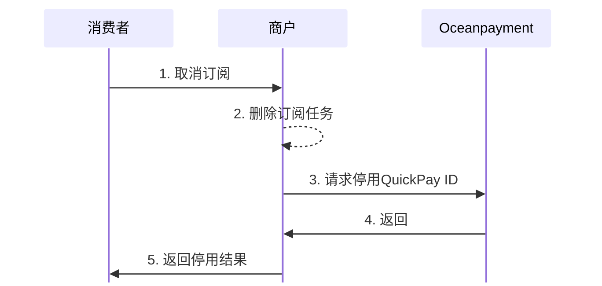

#
import Tabs from '@theme/Tabs';
import TabItem from '@theme/TabItem';

## 概述
取消订阅用于终止用户的自动续费授权。当用户主动取消、付款方式失效、或商户出于业务需要暂停服务时，商户可以直接停用自动扣款功能。

## 流程图

## 状态同步
- 商户应提供“取消自动续费”的入口，确保用户可自由终止订阅；
- 取消操作应在用户界面即时生效，则需要调用Oceanpayment[停用Quickpay ID](/docs/subscripions/disable)。

