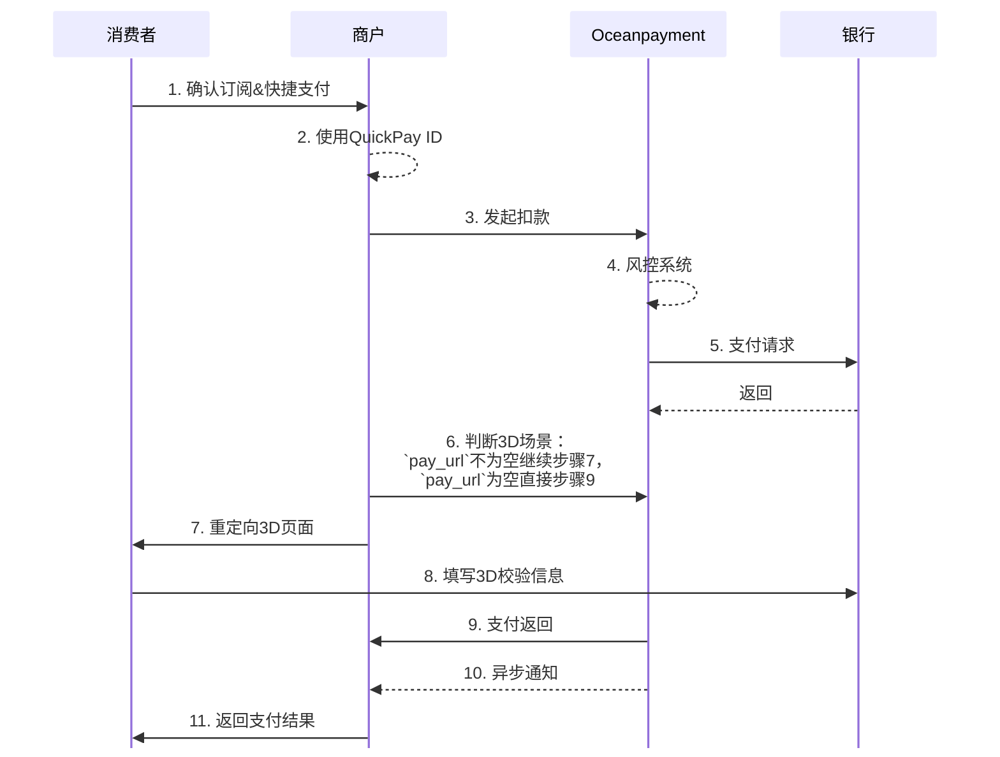

# 
import { FaCode, FaCloudDownloadAlt, FaServer } from 'react-icons/fa';
import Tabs from '@theme/Tabs';
import TabItem from '@theme/TabItem';


## 概述
“发起扣款”是订阅（Subscription）功能中的核心环节。当用户通过首笔交易完成支付授权（即成功生成 QuickPay ID）后，商户可在约定周期内通过该接口，自动向用户的原支付方式发起后续扣款，无需用户再次输入卡信息或确认。


## 流程图


## 工作原理
 1. 商户服务器调用直连模式[提交必要参数](/docs/payment/parameter)， 其中`quickpay_id`参数是卡信息token值。  
```php
cURL -X POST 'https://test-secure.oceanpayment.com/gateway/direct/pay'
-H 'Content-Type: application/x-www-form-urlencoded' \
-d 'account=995149' \
-d 'terminal=99514901' \
-d 'signValue=6b86b273ff34fce19d6b804eff5a3f5747ada4eaa22f1d49c01e52ddb7875b4b' \
-d 'quickpay_id=9ead3654-8f84-4d02-acab-6ac9dd10531f' \
-d 'backUrl=https://www.abc.com/back.php' \
-d 'noticeUrl=https://www.abc.com/notice.php' \
-d 'order_number=NO12345678' \
-d 'order_currency=USD' \
-d 'order_amount=0.01' \
-d 'methods={{methods}}' \
-d 'order_notes=' \
-d 'service_mode=Y1' \
-d 'billing_firstName=test' \
-d 'billing_lastName=test' \
-d 'billing_email=test@gmail.com' \
-d 'billing_phone=13800138000' \
-d 'billing_country=US' \
-d 'billing_state=AL' \
-d 'billing_city=Washington D.C.' \
-d 'billing_address=705A big Road' \
-d 'billing_zip=529012' \
-d 'billing_ip=127.0.0.1' \
-d 'productNum=1' \
-d 'productName=Red Dress' \
-d 'productSku=#001' \
-d 'productPrice=0.01' \
``` 

## 业务模式
:::warning[注意]
在扣款的支付场景中，业务模式字段`service_mode`非常关键，为必传参数。用于识别当前订阅业务流程中的角色（首次、续费等），以及订阅的周期类型（如月度、年度等）。
:::

- `service_mode`参数请按照以下场景进行传值：
<div className="table-container">
<table>
  <tr>
    <th style={{textAlign:"left"}}>类型</th>
    <th style={{textAlign:"left"}}>周期</th>
    <th style={{textAlign:"left"}}>service_mode</th>
  </tr>

  <!-- 单次购买 -->
  <tr>
    <td rowspan="1">单次购买</td>
    <td>-</td>
    <td><code>S1</code></td>
  </tr>

  <!-- 首次购买 -->
  <tr>
    <td rowspan="5">首次购买</td>
    <td>周度</td>
    <td><code>W1</code></td>
  </tr>
  <tr>
    <td>月度</td>
    <td><code>M1</code></td>
  </tr>
  <tr>
    <td>季度</td>
    <td><code>Q1</code></td>
  </tr>
  <tr>
    <td>半年</td>
    <td><code>H1</code></td>
  </tr>
  <tr>
    <td>年度</td>
    <td><code>Y1</code></td>
  </tr>

  <!-- 首次自动续费 -->
  <tr>
    <td rowspan="5">首次自动续费</td>
    <td>周度</td>
    <td><code>W2</code></td>
  </tr>
  <tr>
    <td>月度</td>
    <td><code>M2</code></td>
  </tr>
  <tr>
    <td>季度</td>
    <td><code>Q2</code></td>
  </tr>
  <tr>
    <td>半年</td>
    <td><code>H2</code></td>
  </tr>
  <tr>
    <td>年度</td>
    <td><code>Y2</code></td>
  </tr>

  <!-- 两次及以上自动续费 -->
  <tr>
    <td rowspan="5">两次及以上自动续费</td>
    <td>周度</td>
    <td><code>W3</code></td>
  </tr>
  <tr>
    <td>月度</td>
    <td><code>M3</code></td>
  </tr>
  <tr>
    <td>季度</td>
    <td><code>Q3</code></td>
  </tr>
  <tr>
    <td>半度</td>
    <td><code>H3</code></td>
  </tr>
  <tr>
    <td>年度</td>
    <td><code>Y3</code></td>
  </tr>
</table>

</div>

- 传值示例
```php
-d 'service_mode = Y1' \
```

## 处理返回
1. 在返回参数中：
- xml->`pay_url`字段为空，无3D验证环节，则xml就是返回的支付结果。此时也会触发`noticeUrl`异步通知。
- xml->`pay_url`字段不为空，有3D验证环节，需要重定向打开`pay_url`完成3D校验，支付返回结果会再次发送至`backUrl`，默认用$_POST接收返回。此时也会触发noticeUrl异步通知。
<Tabs> 
  <TabItem value="3D场景" label="3D场景" default>
```xml
<?xml version="1.0" encoding="UTF-8"?>
<response>
    <notice_type>transaction</notice_type>
    <push_dateTime>2025-09-03 10:21:14</push_dateTime>
    <account>995149</account>
    <terminal>99514901</terminal>
    <signValue>924347D8E9C9BAC2EC91449C70540FF49E0DD5711F03E8A871DCA34CED023AB6</signValue>
    <methods>Credit Card</methods>
    <order_number>JSCSE-3128790866</order_number>
    <card_country>PL</card_country>
    <order_currency>USD</order_currency>
    <order_amount>0.01</order_amount>
    <order_notes></order_notes>
    <card_number>411111***1111</card_number>
    <card_type>Visa</card_type>
    <payment_country></payment_country>
    <payment_id>250902111334242179639</payment_id>
    <payment_authType>2</payment_authType>
    <payment_status>-1</payment_status>
    <payment_details>80093:3D Authorized Service not completed</payment_details>
    <payment_solutions></payment_solutions>
    <payment_risk></payment_risk>
    <payment_amount></payment_amount>
    <payment_exchangeRate></payment_exchangeRate>
    <auth_reason></auth_reason>
    <auth_code></auth_code>
    <pay_userId></pay_userId>
    <pay_url>https://secure.oceanpayment.com:443/gateway/direct/redirect?pay_id=af5e28ee57061f4fd1dd307a7bc56c7289d9041d0b5494195d91b7c5166b6e30</pay_url>
</response>
```
- 商户将用户重定向到`pay_url` ：
```php
HTTP/1.2 301 Moved Permanently
Location: {pay_url}
``` 
  </TabItem>
  <TabItem value="非3D场景" label="非3D场景">
```xml
<?xml version="1.0" encoding="UTF-8"?>
<response>
    <notice_type>transaction</notice_type>
    <push_dateTime>2025-09-03 10:21:14</push_dateTime>
    <account>995149</account>
    <terminal>99514901</terminal>
    <signValue>6E48108837603DF6758BD6CE81C9F8AEE6FDC40D14D056C41EBCC1B28B1F2A0D</signValue>
    <methods>Credit Card</methods>
    <order_number>JSCSE-3128790866</order_number>
    <card_country>PL</card_country>
    <order_currency>USD</order_currency>
    <order_amount>0.01</order_amount>
    <order_notes></order_notes>
    <card_number>411111***1111</card_number>
    <card_type>Visa</card_type>
    <payment_country>-</payment_country>
    <payment_id>250903102114589130422</payment_id>
    <payment_authType>0</payment_authType>
    <payment_status>1</payment_status>
    <payment_details>80000:Transaction Approved</payment_details>
    <payment_solutions>None required.</payment_solutions>
    <payment_risk></payment_risk>
    <payment_amount></payment_amount>
    <payment_exchangeRate></payment_exchangeRate>
    <auth_code></auth_code>
    <pay_userId></pay_userId>
</response>
```
  </TabItem>
</Tabs>
2. 查看[付款状态说明](/docs/payment/status)，您也需要通过`noticeUrl`获取交易的[异步通知](/docs/webhook/payments/checkout)。

## 签名
查看详细的[签名和验签](/docs/compliance-and-security/sign/payment)功能。

## API参考
👉即刻探索我们的<a href="../subscripions-api/directpay"><button className="api-button"><FaCode className="w-3 h-3" /> REST API</button></a>。
