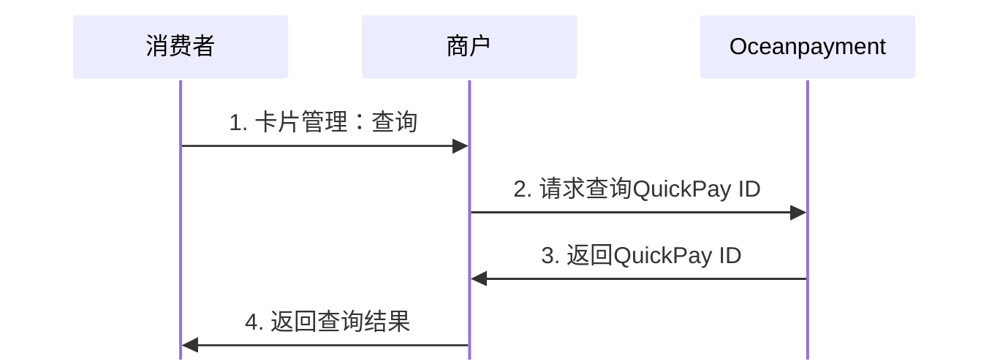

#
import { FaCode, FaCloudDownloadAlt, FaServer } from 'react-icons/fa';
import Tabs from '@theme/Tabs';
import TabItem from '@theme/TabItem';


## 概述
用于查询当前用户或商户绑定的QuickPay ID信息及状态，确认其是否存在并可用于后续支付操作。

## 流程图


## 工作原理
1. 设置请求头组：
```json
'Content-Type:application/json',
'account:995149',
'terminal:99514901',
'secureCode:12345678'
```

2. 调用Oceanpayment[提交必要参数](/docs/subscripions/parameter#查询quickpay-id)查询QuickPay ID。
- `order.referenceId`
- `merchant.referenceId`
- `customer.id`
- `quickpay.id`四选一
```php
cURL -X POST 'https://checkout-s.oceanpayment.com/pg/quickPay/query' \
-d 
{
    "order": {
        "referenceId": "260401093541829655068",
    },
    "merchant": {
        "referenceId": "test20250116094234"
    },
    "customer": {
        "id": "",
    },
    "quickpay": {
        "id": "c6db7a28-7639-4d24-b7c5-6cd222c3e0fc",
    }
}
```

## 处理返回
查看QuickPay ID的状态以及过期时间：[`quickpay.status`](/docs/subscripions/parameter#响应)。
```json
{
    "message": "SUCCESS",
    "code": "000",
    "data": {
        "account": "995149",
        "terminal": "99514901",
        "order": {
            "methods": "{{methods}}",
            "referenceId": "250117093828061010584",
            "remark": "",
            "description": ""
        },
        "merchant": {
            "referenceId": "test20250117093730"
        },
        "quickpay": {
            "id": "test20250117093730",
            "status": "1",
            "expiryTime": "2030-10-01",
        },
        "customer": {
            "id": ""
        }
    }
}
```
