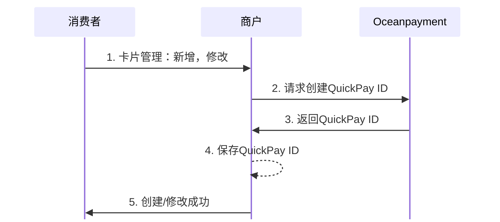

#
import Tabs from '@theme/Tabs';
import TabItem from '@theme/TabItem';

## 概述
QuickPay ID是由Oceanpayment生成的用户支付令牌（Token），用于标识某次成功交易中绑定的支付信息（如信用卡、钱包账户等），是Oceanpayment提供的快捷支付统一入口。

## 流程图

## 开始创建QuickPay ID
如何创建 QuickPay ID？简单来说：
1. 用户第一次支付时，商户调用Oceanpayment接口创建QuickPay ID；
2. 成功后，系统会返回一个唯一的QuickPay ID；
3. 商户可保存此ID，在下次支付时使用；
4. 用户无需再次输入卡号等敏感信息，即可完成支付。  

查看不同支付方式的[集成示例](/docs/subscripions/quickpay-id/credit-card)。

## 管理用户的QuickPay ID
除创建外，商户还需要管理用户卡信息：
- [查询](/docs/subscripions/query)用户的QuickPay ID功能；
- 用户修改卡信息时，需要重新创建QuickPay ID进行替换；
- 用户删除/停用卡信息时，需要[停用](/docs/subscripions/disable)已创建的QuickPay ID。