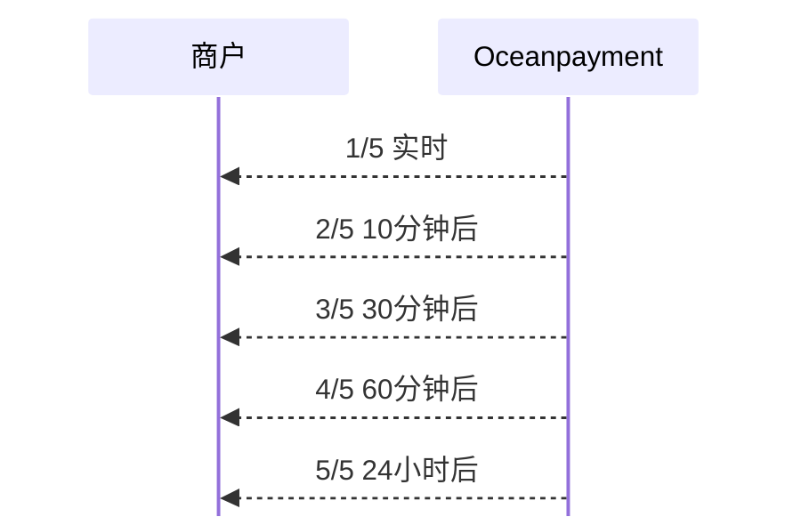

# 

  <h1>交易通知</h1>
  
Webhook是一种高效的服务间实时通信机制，允许Oceanpayment在特定事件（如支付成功、失败、业务交易等）发生时，主动向您的服务器发送通知消息。这种方式相比轮询更加实时和高效。

 
  
:::warning[注意]
接受付款（Payment Accept）的通知配置仅适用于收单接口，不适用于OPCard或OPCCOUNT相关业务场景。
:::

## 通知类型
异步通知触发条件：
- [支付状态通知](/docs/webhook/payments/checkout)（如付款成功、失败等）；
- [业务订单通知](/docs/webhook/payments/orders)（如退款，高风险，争议订单，拒付，伪冒，调单等）；
- [海关上送通知](/docs/webhook/payments/customs-upload)（海关上送结果）。

## 核心特征
1. 通知格式：`xml`；
2. 依赖参数：依赖交易请求中提交的[`noticeUrl`](/docs/payment/parameter)参数。若未提交此参数，则不会发送任何异步通知；
3. 地址端口：只支持**80**和**443**端口；
3. CDN代理：不建议将noticeUrl配置为经过CDN代理的地址。CDN的缓存行为可能导致通知无法送达您的源站服务器，从而造成通知丢失。请直接使用源站服务器IP或未被CDN加速的域名地址。

## 出口IP
Oceanpayment出口IP列表如下，主要用于商户添加IP白名单用途（如需要）：
- 153.254.110.82
- 218.213.69.2
- 52.77.42.94
- 52.220.14.99
- 183.47.51.150
- 47.76.241.251
- 203.131.246.62

## 通知流程

## 通知规范
所有Webhook通知都遵循以下通用规范，请求方式：
- **HTTP Method**: `POST`
- **Content-Type**: `application/xml`
- **字符编码**: `UTF-8`

## 验证步骤
1. 从通知中获取`signValue`字段的值。
2. 根据[支付通知](/docs/webhook/payments/checkout#安全验证签名)和[业务订单](/docs/webhook/payments/orders#安全验证签名)的签名结构规则，计算签名。
3. 将计算得到的签名与通知中的signValue字段进行比较。
4. 如果一致，说明通知是安全的，可以进行业务处理，需返回字符串`receive-ok`。
5. 如果不一致，说明通知可能被篡改或来源不可信，应记录日志并丢弃，但仍需返回字符串receive-ok。

## 重推机制（重要）
为保证通知的可靠性，我们设置了主动重推机制。最多会推送5次。

|重推次数|重推时间间隔（从首次推送开始计算）|说明|
| --- | --- | --- |
|第1次|交易完成后即时|首次推送|
|第2次|10分钟后|第一次重推|
|第3次|30分钟后|第二次重推|
|第4次|60分钟后|第三次重推|
|第5次|24小时后|最后一次重推|

:::warning[注意]
1. **终止条件**：只要在任何一次推送后，Oceanpayment服务器收到您返回的精确字符串receive-ok，则该订单的通知周期立即结束。
2. **最终终止**：如果5次推送均未收到receive-ok响应，则通知周期也会结束，不再进行推送。
3. **重要提示**：除receive-ok外，返回任何其他内容（包括多余的空格、换行、JSON字符串或其他文本）都将被视为失败，并触发下一次重推。
:::

## 幂等性处理
Webhook可能由于重试机制而多次发送同一通知，您的处理逻辑需要保证幂等性。

## 故障排查
|问题现象	|可能原因	|解决方案|
| --- | --- | --- |
|收不到任何通知|• 请求未传`noticeUrl` • noticeUrl地址无法公网访问服务器防火墙 • 服务器防火墙/安全组策略拦截|• 检查noticeUrl传值 • 使用工具检查noticeUrl可达性 • 检查服务器配置|
|收到5次重推后不再推送|商户服务器从未返回receive-ok|• 检查Webhook接口逻辑，确保返回纯文本receive-ok • 检查代码是否有语法错误导致500状态码|
|签名始终验证失败|• 商户密钥 (secureCode) 不正确 • 参数排序或拼接方式错误 • 算法不一致|• 确认密钥 (secureCode) 正确 • 严格按文档规则生成签名字符串 • 确认使用[SHA256](/docs/compliance-and-security/sign/introduction)|

